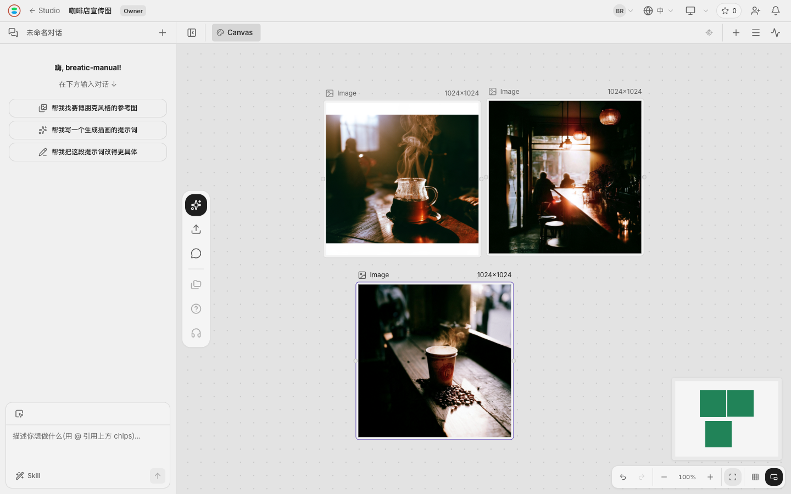

# Breatic

[English](README.md) | **简体中文**

**面向创意团队的实时协作 AI 工作空间。**

将创作简报、场景与媒体组织在同一个项目里。在 Document Space 中写作，在 Canvas Space 中生成和调整素材，与 AI Agent 和团队共同推进创作，让每个环节都保留作品的上下文。

**Beta · 源码可用 · 桌面浏览器**

[在线体验](https://breatic.ai/login) · [使用指南](docs/USAGE-CN.md) · [自行部署](self-host/LOCAL-CN.md) · [发布版本](https://github.com/orime-org/breatic/releases)

*画布示例：在项目聊天旁排列、比较生成的视觉素材。*

## 可以用它做什么

| 核心能力 | 用来完成什么 |
| --- | --- |
| **一个项目，多个 Space** | 将创作简报、各个场景和不同创意方向组织在一起，每个 Space 有独立标签页。 |
| **Document Space（文档空间）** | 用标题、列表和格式化文字编写剧本、镜头描述及制作清单。 |
| **Canvas Space（画布空间）** | 在无限画布上排列参考素材和媒体，结合提示词、模型及参考输入生成、调整资产。 |
| **项目中的 AI Agent** | 讨论创意、提供文档或画布上下文，结合已有素材查看和评审提案。 |
| **实时协作** | 邀请协作者、设置项目访问权限，共同编辑实时同步的画布和文档。 |

支持的媒体包括图片、视频、音频和 3D 资产，具体生成能力取决于已配置的供应商及模型权限。目前可使用 Canvas 和 Document Space；**Timeline 尚未开放**。

## 创作流程：一条 30 秒咖啡店视频

**Studio** 管理项目与资产；**Project（项目）** 汇集一次创作任务的内容；项目里的 **Space** 按场景、交付内容或创意方向拆分工作。

| Space | 类型 | 内容 |
| --- | --- | --- |
| 剧本与创作简报 | Document | 故事、品牌方向、对白及镜头描述 |
| 01 · 开场 · 0–10 秒 | Canvas | 开场镜头的参考素材和候选画面 |
| 02 · 主场景 · 10–20 秒 | Canvas | 场景资产，以及供比较的不同方案 |
| 03 · 结尾 · 20–30 秒 | Canvas | 收尾镜头及其配套素材 |

1. **写下创作简报。** 在文档中描述咖啡店、目标受众和视觉方向。
2. **与 Agent 一起推进。** 将相关上下文加入聊天，讨论镜头，查看和评审它的提案。
3. **创作各个场景。** 选择已配置的模型，添加提示词和参考素材，在对应画布中生成或调整资产。
4. **一起评审和交付。** 与协作者比较结果，选定素材并下载，用于最终制作。

时间范围是创作规划：Space 名称不会设置片段时长，也不会自动合成成片，最终编排请使用视频编辑器。[配图使用指南](docs/USAGE-CN.md#example-from-a-brief-to-a-visual) 展示从简报到视觉素材的实例。

## 开始使用

| 你的目标 | 从这里开始 |
| --- | --- |
| 使用官方在线产品 | 在桌面浏览器中[打开 Breatic](https://breatic.ai/login)，注册或登录 |
| 个人、私密群体或组织内部自行部署 | [个人与局域网部署](self-host/LOCAL-CN.md) |
| 修改源码或参与贡献 | [开发环境搭建](self-host/DEVELOPMENT-CN.md) |

登录后完成个人 Studio 设置，创建项目，用 **+** 添加 Document 或 Canvas Space。写下简报或上传参考素材，再使用聊天和画布工具。[使用指南](docs/USAGE-CN.md) 包含注册、首个项目、画布操作和[快捷键](docs/USAGE-CN.md#keyboard-shortcuts)。

### 自行部署前

Web、API、后台任务和协作服务使用已发布的 Docker 镜像，依赖 PostgreSQL 与 Redis。上传和媒体处理通过部署到**你自己的 Cloudflare 账户**的 Ingest Worker 与媒体容器完成，文件保存在你的 R2 bucket；AI 调用使用你的供应商账户和额度。

这不是离线或完全本地化部署，局域网访问需要可信 HTTPS。云服务与模型调用可能产生费用；SMTP、Google 登录、Stripe 支付和搜索是可选集成。按安装指南完成云端配置与验收，其中一次性的 Node/pnpm/Wrangler 配置步骤不代表日常使用需要启动开发服务器。

## 产品状态与帮助

Breatic 处于 Beta 阶段，持续开发中。已发布版本和更新说明见 [Releases](https://github.com/orime-org/breatic/releases)。

[报告问题](https://github.com/orime-org/breatic/issues/new?template=bug_report.yml) · [建议功能](https://github.com/orime-org/breatic/issues/new?template=feature_request.yml) · [社区交流](https://discord.gg/Yeu6A4aejN)

安全漏洞请按 [SECURITY.md](SECURITY.md) 中的方式私下报告。

## 参与贡献

应用使用 TypeScript、React/Vite、Hono、PostgreSQL、Redis/BullMQ 与 Hocuspocus/Yjs，上传由独立的 Cloudflare Worker 处理。

[贡献流程](CONTRIBUTING.md) · [开发环境搭建](self-host/DEVELOPMENT-CN.md) · [架构说明](docs/ARCHITECTURE.md) · [测试说明](docs/TEST-MANDATE.md)

## 关注 Breatic

[官网](https://breatic.ai) · [Discord](https://discord.gg/Yeu6A4aejN) · [X](https://x.com/breatic_ai) · [YouTube](https://www.youtube.com/@breatic_ai) · [Instagram](https://www.instagram.com/breatic_ai)

## 许可证与允许用途

Breatic 采用 [Breatic Source-Available License v1.0](LICENSE)，属于**源码可用**项目，以 Apache 2.0 为基础附加条款。

许可证允许个人使用、不公开宣传且不开放公众注册的私密群体使用，以及同一组织内部部署。未经另行授权，禁止向公众提供 Breatic 平台，**无论收费还是免费**。是否有域名、是否部署在服务器上，本身不决定允许的访问群体。请保留产品品牌与版权标识。完整条款以许可证为准；面向公众部署的授权咨询请联系 [licensing@orime.ai](mailto:licensing@orime.ai)。

第三方组件及许可说明见 [THIRD-PARTY.md](THIRD-PARTY.md)。

© 2026 Orime, Inc.
