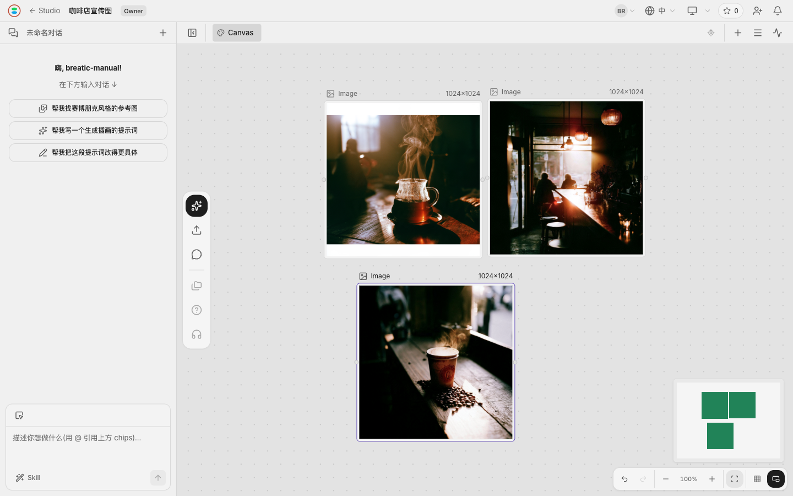
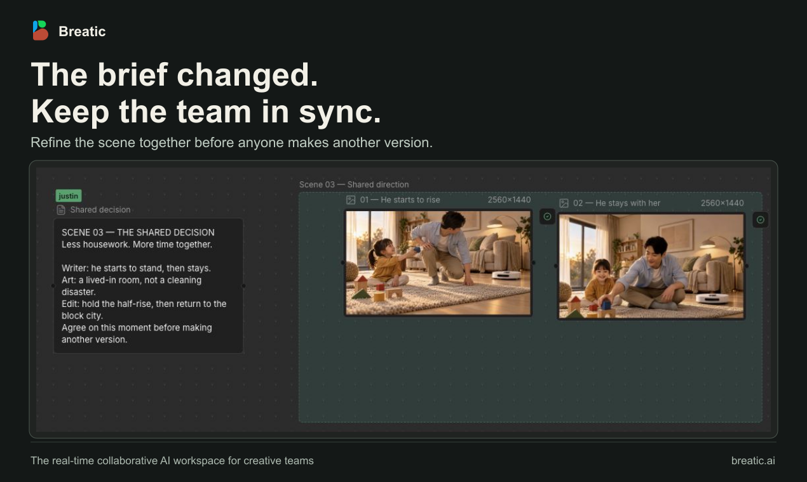
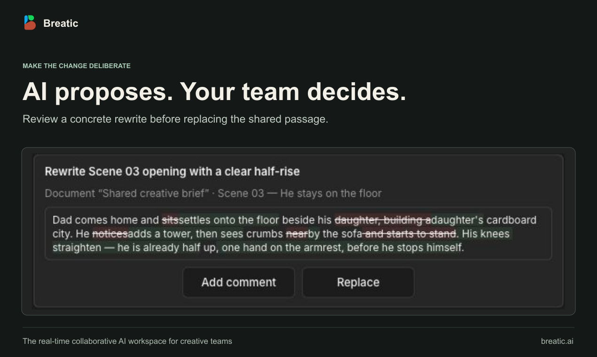

<h1 align="center">Breatic</h1>

<strong>面向创意团队的实时协作 AI 工作空间。</strong>

线上已开放 · 源码公开 · 桌面浏览器

  <a href="https://breatic.ai/?utm_source=github&amp;utm_medium=referral&amp;utm_campaign=repository_listing_202610&amp;utm_content=readme_website_cn">官网</a> ·
  <a href="https://breatic.ai/login?utm_source=github&amp;utm_medium=referral&amp;utm_campaign=repository_listing_202610&amp;utm_content=readme_cn">在线体验</a> ·
  <a href="https://youtu.be/mc1XAqtJD_M">45秒英文演示</a> ·
  <a href="docs/USAGE-CN.md">使用指南</a> ·
  <a href="https://discord.gg/Yeu6A4aejN">Discord</a>

  
  
  
  

  <a href="README.md">English</a> · <strong>简体中文</strong> · <a href="README-TW.md">繁體中文</a> · <a href="README-JA.md">日本語</a> · <a href="README-KO.md">한국어</a> · <a href="README-ES.md">Español</a> · <a href="README-PT-BR.md">Português</a> 
  <a href="README-DE.md">Deutsch</a> · <a href="README-FR.md">Français</a> · <a href="README-AR.md">العربية</a> · <a href="README-RU.md">Русский</a> · <a href="README-UK.md">Українська</a> · <a href="README-TR.md">Türkçe</a> · <a href="README-TH.md">ภาษาไทย</a>

---

将创作简报、场景与媒体组织在同一个项目里。在 Document Space 中写作，在 Canvas Space 中生成和调整素材，与 AI Agent 和团队共同推进创作，让每个环节都保留作品的上下文。

官方在线服务提供免费的 Starter 会员档。AI 生成积分单独购买，不包含在会员套餐内，具体见[会员与积分定价][hosted-pricing]。

*画布示例：在项目聊天旁排列、比较生成的视觉素材。*

## 可以用它做什么

| 核心能力 | 用来完成什么 |
| --- | --- |
| **一个项目，多个 Space** | 将创作简报、各个场景和不同创意方向组织在一起，每个 Space 有独立标签页。 |
| **Document Space（文档空间）** | 用标题、列表和格式化文字编写剧本、镜头描述及制作清单。 |
| **Canvas Space（画布空间）** | 在无限画布上排列参考素材和媒体，结合提示词、模型及参考输入生成、调整资产。 |
| **3D（DEV）** | 在共享三维场景中布置内置对象、导入的 glTF 模型和 AI 生成的模型，编辑位置、旋转及缩放。 |
| **Timeline（DEV）** | 将 Project 视频或本地上传视频编排在共享轨道上：移动、裁剪、分割、复制和删除片段，撤销自己的编辑并预览编排。描述一段网页动画，交给 DeepSeek 制作，在执行列表查看进度，再把结果作为片段加入轨道，按 Timeline 时钟播放。 |
| **项目中的 AI Agent** | 讨论创意、提供文档或画布上下文，结合已有素材查看和评审提案。 |
| **实时协作** | 邀请协作者、设置项目访问权限，共同编辑实时同步的画布、文档、三维场景和 Timeline。 |

支持的媒体包括图片、视频、音频和 3D 资产，具体生成能力取决于已配置的供应商及模型权限。Canvas 和 Document Space 可用，3D 和 Timeline 在两个创建入口均带有 **DEV** 标记；3D 场景内的批注正在开发中。Timeline 当前支持多条画面轨上的视频和网页动画编辑与预览，网页动画只在开启该功能的部署中可用；更多素材类型和视频导出属于后续计划。

## 一起评审和修改

创作简报变了，把修改决定放在作品旁边。这个例子中，两张场景图与共享创作方向在同一画布里，协作者直接在项目中修改了方向说明。

Agent 可以先提出改写方案，团队查看后再决定是否替换共享文档中的段落。

图片来自真实示例项目；故事与场景素材用于演示。

## 创作流程：一条 30 秒咖啡店视频

**Studio** 管理项目与资产；**Project（项目）** 汇集一次创作任务的内容；项目里的 **Space** 按场景、交付内容或创意方向拆分工作。

| Space | 类型 | 内容 |
| --- | --- | --- |
| 剧本与创作简报 | Document | 故事、品牌方向、对白及镜头描述 |
| 01 · 开场 · 0–10 秒 | Canvas | 开场镜头的参考素材和候选画面 |
| 02 · 主场景 · 10–20 秒 | Canvas | 场景资产，以及供比较的不同方案 |
| 03 · 结尾 · 20–30 秒 | Canvas | 收尾镜头及其配套素材 |

1. **写下创作简报。** 在文档中描述咖啡店、目标受众和视觉方向。
2. **与 Agent 一起推进。** 将相关上下文加入聊天，讨论镜头，查看和评审它的提案。
3. **创作各个场景。** 选择已配置的模型，添加提示词和参考素材，在对应画布中生成或调整资产。
4. **一起评审和交付。** 与协作者比较结果，选定素材并下载，用于最终制作。

时间范围是创作规划：Space 名称不会设置片段时长，也不会自动合成成片，可在 Timeline 中编排和预览视频，成片整理与导出由视频编辑器完成。[配图使用指南](docs/USAGE-CN.md#example-from-a-brief-to-a-visual) 展示从简报到视觉素材的实例。

## 开始使用

| 你的目标 | 从这里开始 |
| --- | --- |
| 使用官方在线产品 | 在桌面浏览器中[打开 Breatic][hosted-app]，注册或登录 |
| 个人、私密群体或组织内部自行部署 | [个人与局域网部署](self-host/LOCAL-CN.md) |
| 修改源码或参与贡献 | [开发环境搭建](self-host/DEVELOPMENT-CN.md) |

登录后完成个人 Studio 设置，创建项目，用 **+** 添加 Document、Canvas、3D 或 Timeline Space。写下简报、上传参考素材或布置内置三维对象。[使用指南](docs/USAGE-CN.md) 包含注册、首个项目、Space 操作和[快捷键](docs/USAGE-CN.md#keyboard-shortcuts)。

### 自行部署前

Web、API、后台任务和协作服务使用已发布的 Docker 镜像，依赖 PostgreSQL 与 Redis。上传和媒体处理通过部署到**你自己的 Cloudflare 账户**的 Ingest Worker 与媒体容器完成，文件保存在你的 R2 bucket；AI 调用使用你的供应商账户和额度。

这不是离线或完全本地化部署，局域网访问需要可信 HTTPS。云服务与模型调用可能产生费用；SMTP、Google 登录、Stripe 支付和搜索是可选集成。按安装指南完成云端配置与验收，其中一次性的 Node/pnpm/Wrangler 配置步骤不代表日常使用需要启动开发服务器。

## 产品状态与帮助

Breatic 官方在线服务已开放使用，并持续开发。上文各功能的 DEV 标记与开放范围说明仍然适用。已发布版本和更新说明见 [Releases](https://github.com/orime-org/breatic/releases)。

[报告问题](https://github.com/orime-org/breatic/issues/new?template=bug_report.yml) · [建议功能](https://github.com/orime-org/breatic/issues/new?template=feature_request.yml) · [社区交流](https://discord.gg/Yeu6A4aejN)

安全漏洞请按 [SECURITY.md](SECURITY.md) 中的方式私下报告。

## 参与贡献

应用使用 TypeScript、React/Vite、Hono、PostgreSQL、Redis/BullMQ 与 Hocuspocus/Yjs，上传由独立的 Cloudflare Worker 处理。

[贡献流程](CONTRIBUTING.md) · [开发环境搭建](self-host/DEVELOPMENT-CN.md) · [架构说明](docs/ARCHITECTURE.md) · [测试说明](docs/TEST-MANDATE.md)

## 关注 Breatic

[官网](https://breatic.ai) · [Discord](https://discord.gg/Yeu6A4aejN) · [X](https://x.com/breatic_ai) · [YouTube](https://www.youtube.com/@breatic_ai) · [Instagram](https://www.instagram.com/breatic_ai)

## 许可证与允许用途

Breatic **源码公开**，采用 [Elastic License 2.0](LICENSE)（`Elastic-2.0`）。

你可以阅读、修改和再分发 Breatic，也可以自己使用或在你所在的组织内部部署，包括用于商业工作。你不可以把 Breatic 作为托管服务或代管服务提供给第三方。完整条款以许可证为准。

Breatic 的名称和标识是 Orime, Inc. 的商标，不在许可证授权范围内，使用规则见 [TRADEMARKS.md](TRADEMARKS.md)。许可证不限制你用 Breatic 创作的内容。

### 生成内容

Breatic 是 AI 辅助内容创作工具。Breatic 实例的运营者和用户须自行负责：生成内容符合适用法律（版权、商标、隐私、数据保护、名誉权与内容审核），对所提供的输入及其后续使用拥有相应权利，并按使用场景做好内容审核。Orime, Inc. 不对生成内容的准确性、合法性、原创性或安全性作任何保证。

第三方组件及许可说明见 [THIRD-PARTY.md](THIRD-PARTY.md)。

[hosted-app]: https://breatic.ai/login?utm_source=github&utm_medium=referral&utm_campaign=repository_listing_202610&utm_content=readme_cn
[hosted-pricing]: https://breatic.ai/zh-CN/pricing/?utm_source=github&utm_medium=referral&utm_campaign=repository_listing_202610&utm_content=readme_pricing_cn

© 2026 Orime, Inc.
