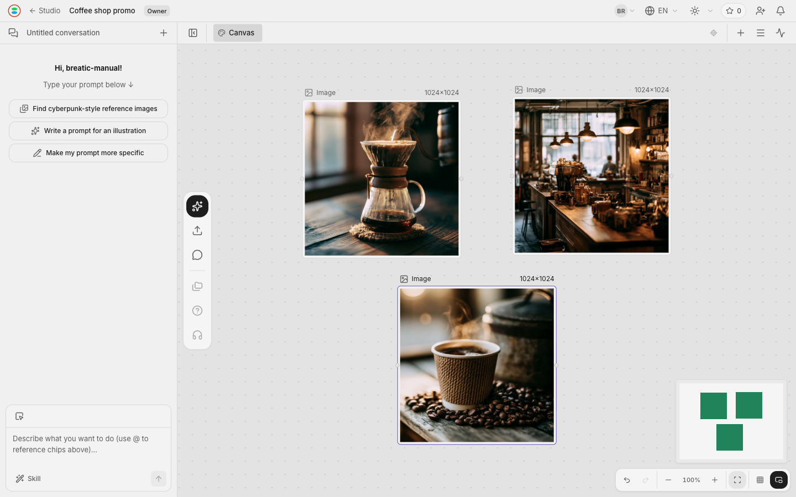
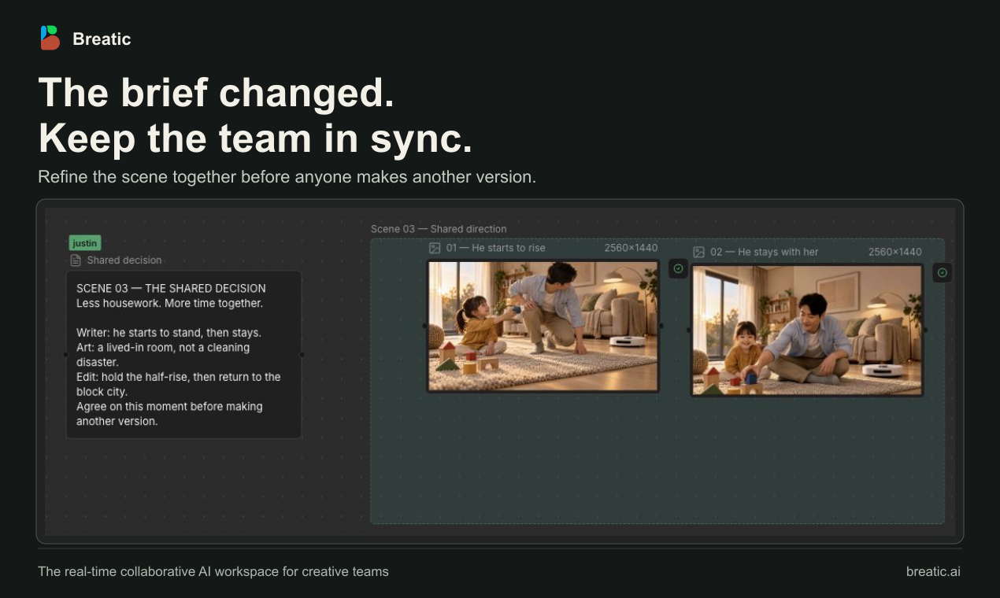
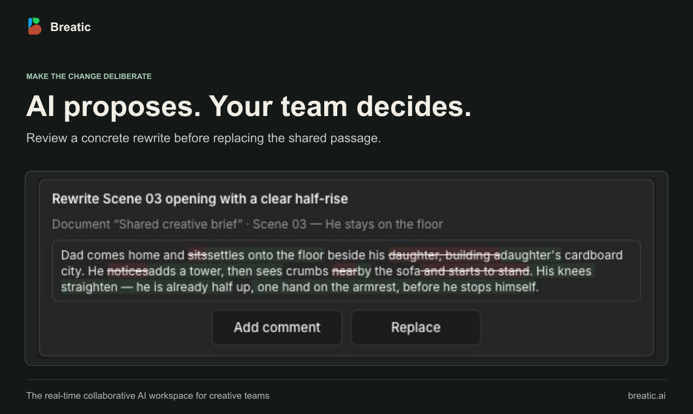

<h1 align="center">Breatic</h1>

<strong>Der KI-Arbeitsbereich für Kreativteams mit Zusammenarbeit in Echtzeit.</strong>

Online verfügbar · Quellcode verfügbar · Desktop-Browser

  <a href="https://breatic.ai/?utm_source=github&amp;utm_medium=referral&amp;utm_campaign=repository_listing_202610&amp;utm_content=readme_website_de">Website</a> ·
  <a href="https://breatic.ai/login?utm_source=github&amp;utm_medium=referral&amp;utm_campaign=repository_listing_202610&amp;utm_content=readme_de">Breatic testen</a> ·
  <a href="https://youtu.be/mc1XAqtJD_M">45-Sekunden-Demo (Englisch)</a> ·
  <a href="docs/USAGE.md">Anleitung (Englisch)</a> ·
  <a href="https://discord.gg/Yeu6A4aejN">Discord</a>

  
  
  
  

  <a href="README.md">English</a> · <a href="README-CN.md">简体中文</a> · <a href="README-TW.md">繁體中文</a> · <a href="README-JA.md">日本語</a> · <a href="README-KO.md">한국어</a> · <a href="README-ES.md">Español</a> · <a href="README-PT-BR.md">Português</a> 
  <strong>Deutsch</strong> · <a href="README-FR.md">Français</a> · <a href="README-AR.md">العربية</a> · <a href="README-RU.md">Русский</a> · <a href="README-UK.md">Українська</a> · <a href="README-TR.md">Türkçe</a> · <a href="README-TH.md">ภาษาไทย</a>

---

Bringe Briefing, Szenen und Medien in einem Project zusammen. Schreibe in Document Spaces, erzeuge und verfeinere Inhalte in Canvas Spaces und arbeite mit einem KI-Agenten und deinem Team im Kontext der Produktion.

Der gehostete Dienst bietet einen kostenlosen Starter-Tarif. Credits für die KI-Generierung werden separat gekauft und sind nicht in Mitgliedschaften enthalten. Siehe [Preise und Credits][hosted-pricing].

## Ein Projekt, vier kreative Arbeitsbereiche für die Zusammenarbeit

In Breatic kannst du beim Arbeiten das Skript überarbeiten, Bildideen ausprobieren, Szenen arrangieren und Einstellungen anordnen. Im Team können alle gleichzeitig im selben Projekt arbeiten.

| Funktion | **Breatic** | Higgsfield | TapNow | LibTV | Luma | LTX Studio |
| --- | :---: | :---: | :---: | :---: | :---: | :---: |
| **Gemeinsame Dokumentbearbeitung** | ✅ | ✗ | ✗ | ✗ | ✗ | ✗ |
| **Gemeinsamer Canvas** | ✅ | ✅ | ✅ | ✅ | ✅ | ✅ |
| **Gemeinsame 3D-Bearbeitung** | ✅ | ✗ | ✗ | ✗ | ✗ | ✗ |
| **Gemeinsame Zeitleiste** | ✅ | ✗ | ✗ | ✗ | ✗ | ✗ |
| 3D-Previsualisierung | ✅ | ✅ | ✅ | ✅ | ✗ | ✗ |
| Zeitleistenbearbeitung | ✅ | ✗ | ✅ | ✅ | ✗ | ✅ |
| Projekt-Agent | ✅ | ✅ | ✅ | ✅ | ✅ | ✗ |
| Textvorschläge prüfen | ✅ | ✗ | ✗ | ✗ | ✗ | ✗ |
| Mit dem Team teilen | ✅ | ✅ | ✅ | ✅ | ✅ | ✅ |

Zusammenarbeit bedeutet, dass mehrere Personen denselben Arbeitsbereich in Echtzeit bearbeiten können. Bei Textvorschlägen kannst du die Änderung des Agenten prüfen, bevor du entscheidest, ob du sie in den Originaltext übernimmst. Der Vergleich basiert auf öffentlich zugänglichen Produktinformationen mit Stand vom 18. November 2026. ✅ steht für bestätigte Unterstützung, ✗ für anhand öffentlicher Informationen nicht bestätigte Unterstützung.

## Was du damit machen kannst

| Funktion | Einsatz |
| --- | --- |
| **Projects mit mehreren Spaces** | Briefing, Szenen und kreative Alternativen in eigenen Tabs organisieren. |
| **Document Spaces** | Drehbücher, Einstellungen und Produktionslisten mit formatiertem Text verfassen. |
| **Canvas Spaces** | Referenzen und Medien auf einer unendlichen Arbeitsfläche anordnen; Inhalte mit Prompts, Modellen und Referenzen erzeugen und verfeinern. |
| **3D (DEV)** | Integrierte Objekte in einer gemeinsamen Szene platzieren sowie Position, Drehung und Skalierung bearbeiten. |
| **Timeline (DEV)** | Videos aus dem Project oder lokal hochgeladene Videos auf gemeinsamen Spuren anordnen: Clips verschieben, trimmen, teilen, duplizieren und löschen, eigene Änderungen rückgängig machen und die Sequenz abspielen. Fertige Web Animations aus Motion Spaces als Clips einfügen, die im Takt der Timeline laufen; jedes Einfügen ist eine unabhängige Kopie. Videos und Web Animations aller Spuren laufen als übereinanderliegende Ebenen gemeinsam; eine Ebene in der Vorschau auswählen, um sie zu verschieben, zu skalieren, zu strecken oder zu drehen, oder Position und Größe eingeben. Am Ende der Wiedergabeleiste das Seitenverhältnis aus sieben Vorgaben wählen (16:9, 9:16, 1:1, 4:3, 4:5, 2:3, 21:9); die Ebenen behalten ihren Platz im Bild. |
| **Motion (DEV)** | Eine Web Animation beschreiben und von DeepSeek erstellen lassen, Ausführungen nach abgeschlossen, laufend und fehlgeschlagen verfolgen, fertige Ergebnisse abspielen und darin springen, ein Ergebnis zu einem neuen abändern, Zeitpunkte gemeinsam mit anderen annotieren, ein Ergebnis als Video exportieren und das Video auf einen Canvas legen. |
| **KI-Agent im Projekt** | Ideen besprechen, Dokument- und Canvas-Kontext bereitstellen und Vorschläge zusammen mit deinen Materialien prüfen. |
| **Zusammenarbeit in Echtzeit** | Teammitglieder einladen, Berechtigungen festlegen und synchronisierte Canvases, Dokumente, 3D-Szenen, Timelines und Motion Spaces bearbeiten. |

Unterstützte Medien sind Bilder, Videos, Audio und 3D-Dateien. Die Generierung hängt von den eingerichteten Anbietern und dem Modellzugang ab. Canvas und Document sind verfügbar; 3D, Timeline und Motion tragen die Kennzeichnung **DEV**. Die Timeline unterstützt derzeit Bearbeitung und Vorschau von Videos und Web Animations auf mehreren Bildspuren; Motion erstellt, ändert und exportiert Web Animations, die nur in Installationen zur Verfügung stehen, die sie aktivieren. Weitere Medientypen für die Timeline und der Videoexport der Timeline sind geplant. Modellgenerierung und Anmerkungen innerhalb der 3D-Szene sind in Entwicklung.

## Änderungen gemeinsam prüfen

Halte Entscheidungen direkt neben der Arbeit fest. Ein Teammitglied kann die gemeinsame kreative Richtung ändern, während das Team zwei Szenenbilder vergleicht. Der Agent kann eine Überarbeitung vorschlagen, bevor eine Textpassage ersetzt wird. Das Team entscheidet, was bleibt.

Die Aufnahmen stammen aus einem echten Beispielprojekt; Geschichte und Szenenmaterial dienen der Veranschaulichung.

## Ein kreativer Ablauf: ein 30-Sekunden-Video für ein Café

Ein **Studio** enthält Projekte und Assets. Ein **Project** bündelt eine Produktion; seine **Spaces** teilen die Arbeit nach Szene, Ergebnis oder kreativer Richtung auf.

1. **Briefing schreiben:** Geschichte, Zielgruppe, Dialog und Bildsprache in einem Document Space festhalten.
2. **Mit dem Agenten arbeiten:** relevanten Kontext im Chat bereitstellen, Einstellungen besprechen und Vorschläge prüfen.
3. **Szenen entwickeln:** in Canvas Spaces ein eingerichtetes Modell wählen, Prompts und Referenzen ergänzen und Varianten vergleichen.
4. **Prüfen und übergeben:** gemeinsam passende Assets auswählen und für die Produktion herunterladen.

Spaces können etwa „Auftakt · 0–10 s“, „Hauptszene · 10–20 s“ und „Schluss · 20–30 s“ heißen. Diese Namen dienen der Planung; sie legen keine Clipdauer fest und erstellen keinen fertigen Film. Verwende Timeline für Anordnung und Vorschau und deinen Videoeditor für Fertigstellung und Export. Siehe das [bebilderte Beispiel (Englisch)](docs/USAGE.md#example-from-a-brief-to-a-visual).

## Einstieg

- **Gehostetes Produkt:** [Breatic öffnen][hosted-app], im Desktop-Browser registrieren oder anmelden.
- **Eigene Installation:** [Anleitung für persönliche Nutzung und LAN (Englisch)](self-host/LOCAL.md).
- **Entwicklung:** [Entwicklungsumgebung einrichten (Englisch)](self-host/DEVELOPMENT.md).

Richte dein persönliches Studio ein, erstelle ein Project und füge über **+** Document, Canvas, 3D, Timeline oder Motion Spaces hinzu. Beginne mit einem Briefing, lade Referenzen hoch oder platziere integrierte 3D-Objekte. Die [Anleitung (Englisch)](docs/USAGE.md) enthält auch [Tastenkürzel](docs/USAGE.md#keyboard-shortcuts).

### Vor dem Selbsthosting

Die Installation verwendet veröffentlichte Docker-Images für Web, API, Hintergrundaufgaben und Zusammenarbeit sowie PostgreSQL und Redis. Uploads und Medienverarbeitung benötigen einen Ingest Worker und einen Mediencontainer in **deinem Cloudflare-Konto**; gespeichert wird in deinem R2-Bucket. KI-Aufrufe verwenden deine Anbieterkonten und Kontingente.

Dies ist keine Offline- oder vollständig lokale Installation. LAN-Zugriff benötigt vertrauenswürdiges HTTPS. Cloud-Dienste und Modellaufrufe können Kosten verursachen; SMTP, Google-Anmeldung und Suche sind optionale Integrationen; der Verkauf von Credits oder Mitgliedschaften darf nur mit schriftlicher Genehmigung von Orime, Inc. aktiviert werden (LICENSE, Abschnitte 10 und 11). Folge der Anleitung zur Cloud-Einrichtung und Prüfung. Der einmalige Node/pnpm/Wrangler-Schritt dient dem Deployment; für die normale Nutzung läuft kein Entwicklungsserver.

## Status, Hilfe und Beiträge

Der gehostete Dienst ist verfügbar und wird weiterentwickelt; die genannten DEV-Markierungen und Grenzen gelten weiterhin. Veröffentlichte Versionen stehen unter [Releases](https://github.com/orime-org/breatic/releases).

[Fehler melden](https://github.com/orime-org/breatic/issues/new?template=bug_report.yml) · [Funktion vorschlagen](https://github.com/orime-org/breatic/issues/new?template=feature_request.yml) · [Discord](https://discord.gg/Yeu6A4aejN)

Sicherheitslücken bitte gemäß [SECURITY.md](SECURITY.md) vertraulich melden. Das Projekt verwendet TypeScript, React/Vite, Hono, PostgreSQL, Redis/BullMQ und Hocuspocus/Yjs sowie einen separaten Cloudflare Worker für Uploads.

[Mitwirken](CONTRIBUTING.md) · [Architektur](docs/ARCHITECTURE.md) · [Tests](docs/TEST-MANDATE.md)

[Website](https://breatic.ai) · [X](https://x.com/breatic_ai) · [YouTube](https://www.youtube.com/@breatic_ai) · [Instagram](https://www.instagram.com/breatic_ai)

## Lizenz und erlaubte Nutzung

Breatic ist **Source-Available-Software** unter der [Breatic Source-Available License 2.0](LICENSE), einer von der Apache License 2.0 abgeleiteten Lizenz mit zusätzlichen Bedingungen. Sie ist keine von der OSI anerkannte Open-Source-Lizenz.

- Du darfst Breatic für die persönliche Nutzung, für eine private nichtkommerzielle Gruppe oder für die Nutzung innerhalb deiner Organisation, auch in deinem Unternehmen, ohne Softwarelizenzgebühr beziehen, ändern und selbst hosten (LICENSE, Abschnitt 10).
- Du darfst mit Breatic kreative Werke wie Filme, Werbung, Bilder, Audio und 3D-Assets erstellen und verkaufen; die Bedingungen stehen in LICENSE, Abschnitte 10 und 13.
- Ohne gesonderte schriftliche Genehmigung von Orime, Inc. muss eine von dir betriebene Instanz im Selbstbereitstellungsmodus (Self-Deployment Mode) laufen: In-App-Käufe von Credits, kostenpflichtige Mitgliedschaften, Abonnements und andere Funktionen für den kostenpflichtigen Betrieb bleiben deaktiviert (LICENSE, Abschnitt 10).
- Breatic oder einen wesentlichen Teil seiner Plattformfunktionen Personen außerhalb dieser Nutzungen zu einem kommerziellen Zweck zur Verfügung zu stellen, erfordert eine gesonderte schriftliche Genehmigung (LICENSE, Abschnitt 11).
- Lass den Namen Breatic und das mitgelieferte Logo im Identitätsbereich der Anwendung sichtbar und halte die Lizenz- und Namensnennungshinweise erreichbar (LICENSE, Abschnitt 12). Orime, Inc. ist ein autorisierter Lizenzgeber der Breatic-Marken; [TRADEMARKS.md](TRADEMARKS.md) beschreibt die Regeln für die Markennutzung.
- Versionen, die unter einer früheren Lizenz veröffentlicht wurden, einschließlich AGPL-3.0-only, behalten die Lizenz, unter der sie veröffentlicht wurden (LICENSE, Abschnitt 15).

Die vollständigen Bedingungen stehen in [LICENSE](LICENSE).

### Generierte Inhalte

Betreiber und Nutzer einer Instanz sind dafür verantwortlich, dass generierte Inhalte geltendes Recht einhalten — etwa Urheber-, Marken-, Datenschutz- und Persönlichkeitsrecht sowie Vorgaben zur Inhaltsmoderation. Sie müssen die Rechte an ihren Eingaben und deren weiterer Nutzung besitzen und Inhalte im jeweiligen Nutzungskontext moderieren. Orime, Inc. übernimmt keine Gewähr für Richtigkeit, Rechtmäßigkeit, Originalität oder Sicherheit generierter Inhalte.

Komponenten Dritter und ihre Hinweise sind in [THIRD-PARTY.md](THIRD-PARTY.md) dokumentiert.

[hosted-app]: https://breatic.ai/login?utm_source=github&utm_medium=referral&utm_campaign=repository_listing_202610&utm_content=readme_de
[hosted-pricing]: https://breatic.ai/pricing/?utm_source=github&utm_medium=referral&utm_campaign=repository_listing_202610&utm_content=readme_pricing_de

© 2026 Orime, Inc.
