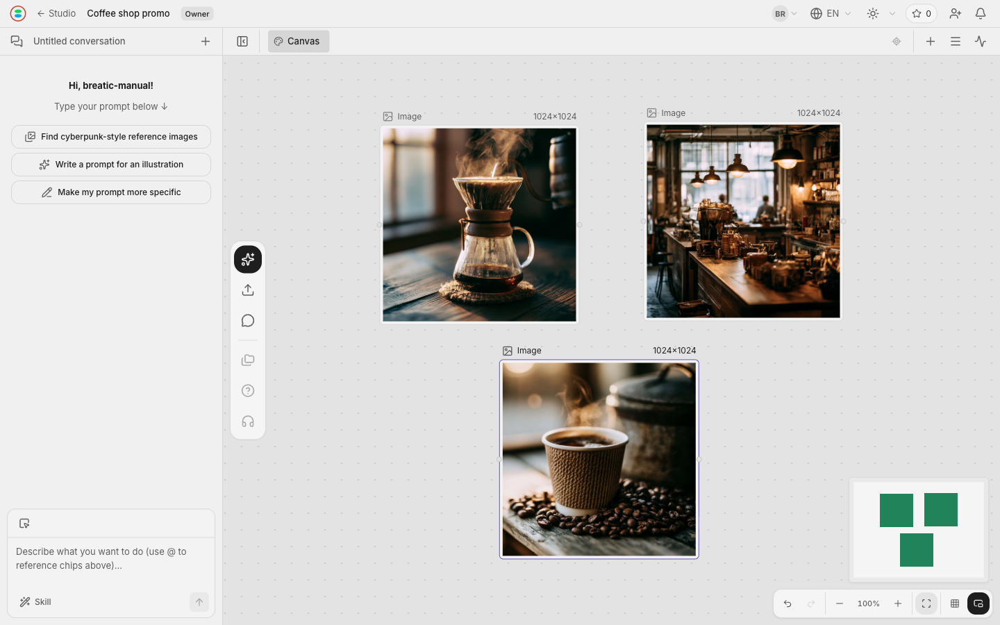
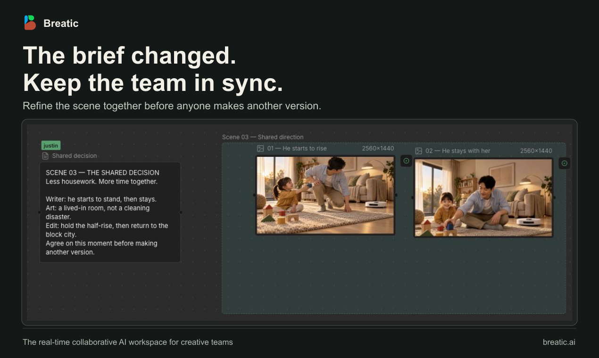
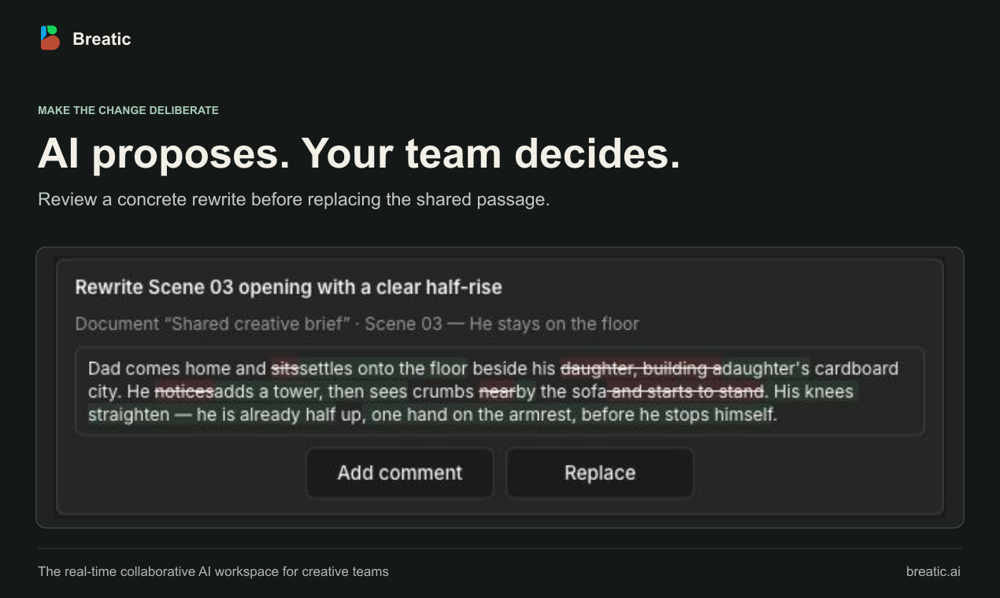

<h1 align="center">Breatic</h1>

<strong>L’espace de travail collaboratif avec IA, en temps réel, pour les équipes créatives.</strong>

Disponible en ligne · Open source · Navigateur de bureau

  <a href="https://breatic.ai/?utm_source=github&amp;utm_medium=referral&amp;utm_campaign=repository_listing_202610&amp;utm_content=readme_website_fr">Site web</a> ·
  <a href="https://breatic.ai/login?utm_source=github&amp;utm_medium=referral&amp;utm_campaign=repository_listing_202610&amp;utm_content=readme_fr">Essayer Breatic</a> ·
  <a href="https://youtu.be/mc1XAqtJD_M">Démo de 45 s (anglais)</a> ·
  <a href="docs/USAGE.md">Guide (anglais)</a> ·
  <a href="https://discord.gg/Yeu6A4aejN">Discord</a>

  
  
  
  

  <a href="README.md">English</a> · <a href="README-CN.md">简体中文</a> · <a href="README-TW.md">繁體中文</a> · <a href="README-JA.md">日本語</a> · <a href="README-KO.md">한국어</a> · <a href="README-ES.md">Español</a> · <a href="README-PT-BR.md">Português</a> 
  <a href="README-DE.md">Deutsch</a> · <strong>Français</strong> · <a href="README-AR.md">العربية</a> · <a href="README-RU.md">Русский</a> · <a href="README-UK.md">Українська</a> · <a href="README-TR.md">Türkçe</a> · <a href="README-TH.md">ภาษาไทย</a>

---

Réunissez le brief, les scènes et les médias dans un même Project. Rédigez dans les Document Spaces, générez et affinez les ressources dans les Canvas Spaces, et travaillez avec un agent IA et vos collaborateurs en conservant le contexte de la production.

Le service hébergé propose une formule Starter gratuite. Les crédits de génération IA s’achètent séparément et ne sont pas inclus dans les abonnements. Consultez les [tarifs et crédits][hosted-pricing].

## Un projet, quatre espaces de création collaboratifs

Dans Breatic, vous pouvez revoir le scénario, explorer des pistes visuelles, mettre en place les scènes et agencer les plans au fil du projet. En équipe, chacun peut travailler en même temps dans le même projet.

| Fonctionnalité | **Breatic** | Higgsfield | TapNow | LibTV | Luma | LTX Studio |
| --- | :---: | :---: | :---: | :---: | :---: | :---: |
| **Documents collaboratifs** | ✅ | ✗ | ✗ | ✗ | ✗ | ✗ |
| **Canevas collaboratif** | ✅ | ✅ | ✅ | ✅ | ✅ | ✅ |
| **Édition 3D collaborative** | ✅ | ✗ | ✗ | ✗ | ✗ | ✗ |
| **Timeline collaborative** | ✅ | ✗ | ✗ | ✗ | ✗ | ✗ |
| Prévisualisation 3D | ✅ | ✅ | ✅ | ✅ | ✗ | ✗ |
| Montage sur timeline | ✅ | ✗ | ✅ | ✅ | ✗ | ✅ |
| Agent de projet | ✅ | ✅ | ✅ | ✅ | ✅ | ✗ |
| Relecture des reformulations | ✅ | ✗ | ✗ | ✗ | ✗ | ✗ |
| Partage avec l’équipe | ✅ | ✅ | ✅ | ✅ | ✅ | ✅ |

La collaboration permet à plusieurs personnes de modifier le même espace en temps réel. Vous pouvez examiner les changements proposés par l’agent avant de décider de les appliquer au texte d’origine. La comparaison s’appuie sur les informations publiques disponibles au 18 novembre 2026. ✅ indique une prise en charge confirmée et ✗ indique qu’elle n’a pas pu être confirmée à partir des informations publiques.

## Ce que vous pouvez faire

| Fonctionnalité | Utilisation |
| --- | --- |
| **Projects avec plusieurs Spaces** | Organiser le brief, les scènes et les pistes créatives dans des onglets distincts. |
| **Document Spaces** | Rédiger des scripts, descriptions de plans et listes de production avec du texte mis en forme. |
| **Canvas Spaces** | Disposer références et médias sur un canevas infini ; générer et affiner des ressources avec des prompts, des modèles et des références. |
| **3D (DEV)** | Placer des objets intégrés dans une scène partagée et modifier leur position, rotation et échelle. |
| **Timeline (DEV)** | Agencer des vidéos du Project ou des vidéos locales importées sur des pistes partagées : déplacer, rogner, scinder, dupliquer et supprimer des clips, annuler ses propres modifications et prévisualiser la séquence. Ajouter des Web Animations terminées depuis les Motion Spaces sous forme de clips qui suivent l’horloge de la Timeline ; chaque ajout est une copie indépendante. Les vidéos et Web Animations de toutes les pistes sont lues ensemble comme des calques superposés ; sélectionner un calque dans l’aperçu pour le déplacer, le mettre à l’échelle, l’étirer ou le faire pivoter, ou saisir sa position et sa taille. Choisir le format de l’image parmi sept préréglages (16:9, 9:16, 1:1, 4:3, 4:5, 2:3, 21:9) au bout de la barre de lecture ; les calques gardent leur place dans l’image. |
| **Motion (DEV)** | Décrire une Web Animation et la faire créer par DeepSeek, suivre les exécutions terminées, en cours et en échec, lire et parcourir les résultats terminés, modifier un résultat pour en obtenir un nouveau, annoter des moments avec ses collaborateurs, exporter un résultat en vidéo et placer la vidéo sur un Canvas. |
| **Agent IA dans le projet** | Échanger des idées, fournir le contexte du document ou du canevas et examiner les propositions avec vos ressources. |
| **Collaboration en temps réel** | Inviter des collaborateurs, définir les droits d’accès et travailler sur des canevas, documents, scènes 3D et Timelines synchronisés. |

Les médias pris en charge comprennent les images, la vidéo, l’audio et les ressources 3D. La génération dépend des fournisseurs configurés et de l’accès aux modèles. Canvas et Document sont disponibles ; 3D, Timeline et Motion portent la mention **DEV**. La Timeline actuelle permet l’édition et la prévisualisation de vidéos et de Web Animations sur plusieurs pistes visuelles ; Motion crée, modifie et exporte des Web Animations, disponibles uniquement dans les déploiements qui les activent. D’autres types de médias pour la Timeline et l’export vidéo de la Timeline sont prévus. La génération par modèles et les annotations au sein de la scène 3D sont en développement.

## Examiner les modifications ensemble

Gardez les décisions à côté du travail. Un collaborateur peut modifier la direction partagée pendant que l’équipe compare deux images de scène. L’agent peut proposer une réécriture avant de remplacer un passage du document : l’équipe décide quoi conserver.

Ces captures proviennent d’un véritable projet d’exemple ; l’histoire et les ressources servent d’illustration.

## Un parcours créatif : une vidéo de café de 30 secondes

Un **Studio** regroupe projets et ressources. Un **Project** réunit une production ; ses **Spaces** répartissent le travail par scène, livrable ou direction créative.

1. **Rédigez le brief** dans un Document Space : histoire, public, dialogues et direction visuelle.
2. **Travaillez avec l’agent :** apportez le contexte pertinent au chat, discutez des plans et examinez ses propositions.
3. **Développez chaque scène** dans un Canvas Space : choisissez un modèle configuré, ajoutez prompts et références, puis comparez les variantes.
4. **Révisez et livrez :** sélectionnez les ressources avec vos collaborateurs et téléchargez-les pour la production.

Vous pouvez nommer les Spaces « Ouverture · 0–10 s », « Scène principale · 10–20 s » et « Fin · 20–30 s ». Ces noms servent à planifier ; ils ne fixent pas la durée des clips et n’assemblent pas automatiquement une vidéo. Utilisez Timeline pour l’agencement et la prévisualisation, puis votre logiciel de montage pour la finition et l’export. Voir l’[exemple illustré (anglais)](docs/USAGE.md#example-from-a-brief-to-a-visual).

## Bien démarrer

- **Service hébergé :** [ouvrez Breatic][hosted-app] dans un navigateur de bureau, puis créez un compte ou connectez-vous.
- **Installation autonome :** suivez le [guide personnel et réseau local (anglais)](self-host/LOCAL.md).
- **Développement :** consultez la [mise en place de l’environnement (anglais)](self-host/DEVELOPMENT.md).

Configurez votre Studio personnel, créez un Project et utilisez **+** pour ajouter des Document, Canvas, 3D ou Timeline Spaces. Commencez par un brief, importez des références ou placez des objets 3D intégrés. Le [guide d’utilisation (anglais)](docs/USAGE.md) présente les [raccourcis clavier](docs/USAGE.md#keyboard-shortcuts).

### Avant d’auto-héberger

L’installation utilise des images Docker publiées pour le web, l’API, les tâches en arrière-plan et la collaboration, avec PostgreSQL et Redis. Les transferts et le traitement des médias utilisent un Ingest Worker et un conteneur média dans **votre compte Cloudflare**, avec stockage dans votre bucket R2. Les appels IA utilisent vos comptes fournisseurs et vos quotas.

Il ne s’agit pas d’une installation hors ligne ou entièrement locale. L’accès en réseau local nécessite un HTTPS de confiance. Les services cloud et les appels aux modèles peuvent être payants ; SMTP, la connexion Google, les paiements Stripe et la recherche sont optionnels. Suivez le guide pour configurer et vérifier le cloud. L’étape initiale Node/pnpm/Wrangler est une opération de déploiement, pas un serveur de développement à maintenir pour l’usage quotidien.

## État, aide et contributions

Le service hébergé est disponible et le développement continue ; les mentions DEV et limites ci-dessus restent applicables. Consultez les [versions publiées](https://github.com/orime-org/breatic/releases).

[Signaler un problème](https://github.com/orime-org/breatic/issues/new?template=bug_report.yml) · [Proposer une fonctionnalité](https://github.com/orime-org/breatic/issues/new?template=feature_request.yml) · [Discord](https://discord.gg/Yeu6A4aejN)

Pour les vulnérabilités, utilisez le canal privé décrit dans [SECURITY.md](SECURITY.md). Le projet utilise TypeScript, React/Vite, Hono, PostgreSQL, Redis/BullMQ et Hocuspocus/Yjs, ainsi qu’un Cloudflare Worker distinct pour les transferts.

[Contribuer](CONTRIBUTING.md) · [Architecture](docs/ARCHITECTURE.md) · [Tests](docs/TEST-MANDATE.md)

[Site web](https://breatic.ai) · [X](https://x.com/breatic_ai) · [YouTube](https://www.youtube.com/@breatic_ai) · [Instagram](https://www.instagram.com/breatic_ai)

## Licence et usages autorisés

Breatic est open source sous la [GNU Affero General Public License v3.0](LICENSE) (AGPL-3.0-only). Vous pouvez utiliser, étudier, modifier et auto-héberger Breatic à toutes fins, y compris commerciales. Si vous modifiez Breatic et permettez à d’autres personnes d’utiliser la version modifiée via un réseau, vous devez leur proposer son code source complet sous la même licence. Consultez l’intégralité des conditions dans la licence.

Le nom et le logo sont des marques d’Orime, Inc. et ne sont pas couverts par cette licence ; voir [TRADEMARKS.md](TRADEMARKS.md). La licence ne restreint pas le contenu que vous créez avec Breatic.

### Contenu généré

Les opérateurs et utilisateurs de chaque instance doivent veiller au respect du droit applicable — droits d’auteur, marques, vie privée, protection des données, diffamation et modération —, détenir les droits nécessaires sur leurs entrées et leurs utilisations ultérieures, et modérer les contenus dans leur contexte d’utilisation. Orime, Inc. ne garantit ni l’exactitude, ni la légalité, ni l’originalité, ni la sécurité du contenu généré.

Les composants tiers et leurs notices figurent dans [THIRD-PARTY.md](THIRD-PARTY.md).

[hosted-app]: https://breatic.ai/login?utm_source=github&utm_medium=referral&utm_campaign=repository_listing_202610&utm_content=readme_fr
[hosted-pricing]: https://breatic.ai/pricing/?utm_source=github&utm_medium=referral&utm_campaign=repository_listing_202610&utm_content=readme_pricing_fr

© 2026 Orime, Inc.
