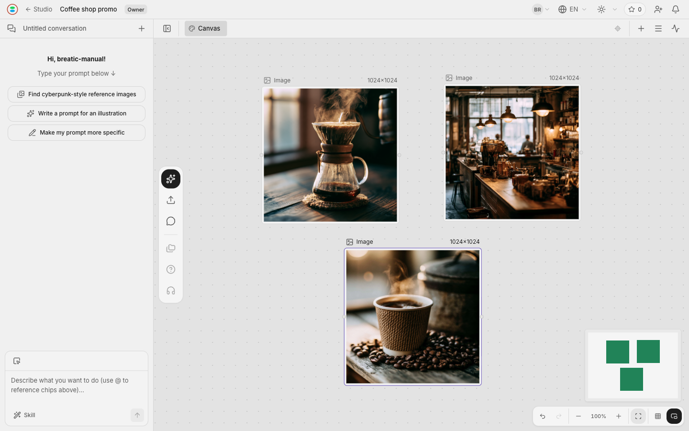

<h1 align="center">Breatic</h1>

<strong>พื้นที่ทำงานสร้างสรรค์ด้วย AI สำหรับทีมที่ทำงานร่วมกันแบบเรียลไทม์</strong>

ใช้งานออนไลน์ได้ · เปิดให้เข้าถึงซอร์สโค้ด · เบราว์เซอร์เดสก์ท็อป

  <a href="https://breatic.ai/?utm_source=github&amp;utm_medium=referral&amp;utm_campaign=repository_listing_202610&amp;utm_content=readme_website_th">เว็บไซต์</a> ·
  <a href="https://breatic.ai/login?utm_source=github&amp;utm_medium=referral&amp;utm_campaign=repository_listing_202610&amp;utm_content=readme_th">ลองใช้ Breatic</a> ·
  <a href="https://youtu.be/mc1XAqtJD_M">เดโม 45 วินาที (ภาษาอังกฤษ)</a> ·
  <a href="docs/USAGE.md">คู่มือ (ภาษาอังกฤษ)</a> ·
  <a href="https://discord.gg/Yeu6A4aejN">Discord</a>

  
  
  
  

  <a href="README.md">English</a> · <a href="README-CN.md">简体中文</a> · <a href="README-TW.md">繁體中文</a> · <a href="README-JA.md">日本語</a> · <a href="README-KO.md">한국어</a> · <a href="README-ES.md">Español</a> · <a href="README-PT-BR.md">Português</a> 
  <a href="README-DE.md">Deutsch</a> · <a href="README-FR.md">Français</a> · <a href="README-AR.md">العربية</a> · <a href="README-RU.md">Русский</a> · <a href="README-UK.md">Українська</a> · <a href="README-TR.md">Türkçe</a> · <strong>ภาษาไทย</strong>

---

รวมบรีฟ ฉาก และสื่อต่าง ๆ ไว้ใน Project เดียว เขียนเนื้อหาใน Document Spaces สร้างและปรับแต่งแอสเซ็ตใน Canvas Spaces แล้วทำงานร่วมกับเอเจนต์ AI และทีมโดยไม่สูญเสียบริบทของงานผลิต

บริการที่โฮสต์มีแผน Starter ฟรี เครดิตสำหรับสร้างเนื้อหาด้วย AI ต้องซื้อแยกและไม่รวมในแผนสมาชิก ดู[ราคาและเครดิต][hosted-pricing]

## ใช้ทำอะไรได้บ้าง

| ความสามารถ | การใช้งาน |
| --- | --- |
| **Projects ที่มีหลาย Spaces** | จัดบรีฟ ฉาก และแนวทางสร้างสรรค์แต่ละแบบไว้ในแท็บแยกกัน |
| **Document Spaces** | เขียนบท คำอธิบายช็อต และรายการงานผลิตด้วยหัวข้อ รายการ และข้อความที่จัดรูปแบบได้ |
| **Canvas Spaces** | วางภาพอ้างอิงและสื่อบนแคนวาสไม่จำกัดขนาด สร้างและปรับแต่งแอสเซ็ตด้วยพรอมป์ต์ โมเดล และข้อมูลอ้างอิง |
| **3D (DEV)** | วางวัตถุที่มีให้ในฉากร่วมกัน แล้วแก้ตำแหน่ง การหมุน และขนาด |
| **Timeline (DEV)** | เพิ่มวิดีโอจาก Project หรืออัปโหลดวิดีโอในเครื่องลงแทร็กภาพที่ใช้ร่วมกัน ปรับเฟรมเริ่มต้นและดูตัวอย่างลำดับ |
| **เอเจนต์ AI ในโปรเจกต์** | พูดคุยไอเดีย ให้บริบทจากเอกสารหรือแคนวาส และตรวจข้อเสนอควบคู่กับสื่อของคุณ |
| **การทำงานร่วมกันแบบเรียลไทม์** | เชิญผู้ร่วมงาน กำหนดสิทธิ์เข้าถึง และแก้ไขแคนวาส เอกสาร ฉาก 3D และ Timeline ที่ซิงก์กัน |

รองรับภาพ วิดีโอ เสียง และแอสเซ็ต 3D ความสามารถในการสร้างขึ้นอยู่กับผู้ให้บริการและสิทธิ์ใช้โมเดลที่ตั้งค่าไว้ Canvas และ Document ใช้งานได้แล้ว ส่วน 3D และ Timeline มีป้าย **DEV** ปัจจุบัน Timeline รองรับการเรียงและดูตัวอย่างวิดีโอบนแทร็กภาพเดียว การตัดต่อหลายแทร็ก สื่อประเภทอื่น Web Animation และการส่งออกวิดีโออยู่ในแผนพัฒนา ส่วนการสร้างด้วยโมเดลและคำอธิบายประกอบภายในฉาก 3D ยังอยู่ระหว่างพัฒนา

## ตรวจการเปลี่ยนแปลงร่วมกัน

เก็บข้อสรุปไว้ข้างชิ้นงาน ผู้ร่วมงานสามารถแก้แนวทางสร้างสรรค์ร่วมกันขณะที่ทีมเปรียบเทียบภาพฉากสองภาพได้ เอเจนต์สามารถเสนอข้อความที่เขียนใหม่ก่อนแทนที่ย่อหน้าในเอกสาร เพื่อให้ทีมตัดสินใจว่าจะเก็บส่วนใดไว้

ภาพหน้าจอมาจากโปรเจกต์ตัวอย่างที่ใช้งานจริง เรื่องราวและแอสเซ็ตของฉากใช้ประกอบการอธิบาย

## ตัวอย่างขั้นตอน: วิดีโอร้านกาแฟ 30 วินาที

**Studio** จัดเก็บโปรเจกต์และแอสเซ็ต **Project** รวมงานผลิตหนึ่งชิ้นไว้ด้วยกัน ส่วน **Spaces** แบ่งงานตามฉาก สิ่งที่จะส่งมอบ หรือแนวทางสร้างสรรค์

1. **เขียนบรีฟ:** บันทึกเรื่องราว กลุ่มเป้าหมาย บทสนทนา และทิศทางภาพใน Document Space
2. **ทำงานกับเอเจนต์:** เพิ่มบริบทที่เกี่ยวข้องในแชต พูดคุยเรื่องช็อตและตรวจข้อเสนอ
3. **สร้างแต่ละฉาก:** เลือกโมเดลที่ตั้งค่าไว้ใน Canvas Spaces เพิ่มพรอมป์ต์และภาพอ้างอิง แล้วเปรียบเทียบผลลัพธ์
4. **ตรวจและส่งมอบ:** เลือกแอสเซ็ตร่วมกับทีมแล้วดาวน์โหลดไปใช้ในงานผลิต

อาจตั้งชื่อ Spaces เป็น “เปิดเรื่อง · 0–10 วินาที”, “ฉากหลัก · 10–20 วินาที” และ “ปิดเรื่อง · 20–30 วินาที” ชื่อเหล่านี้ใช้วางแผน ไม่ได้กำหนดความยาวคลิปหรือประกอบวิดีโอสำเร็จให้อัตโนมัติ ใช้ Timeline เพื่อจัดเรียงและดูตัวอย่าง แล้วใช้โปรแกรมตัดต่อวิดีโอสำหรับงานขั้นสุดท้ายและการส่งออก ดู[ตัวอย่างพร้อมภาพประกอบ (ภาษาอังกฤษ)](docs/USAGE.md#example-from-a-brief-to-a-visual)

## เริ่มต้นใช้งาน

- **บริการที่โฮสต์:** [เปิด Breatic][hosted-app] ในเบราว์เซอร์เดสก์ท็อป แล้วสมัครหรือลงชื่อเข้าใช้
- **ติดตั้งเอง:** ทำตาม[คู่มือสำหรับการใช้งานส่วนตัวและ LAN (ภาษาอังกฤษ)](self-host/LOCAL.md)
- **พัฒนา:** ดู[การตั้งค่าสภาพแวดล้อม (ภาษาอังกฤษ)](self-host/DEVELOPMENT.md)

ตั้งค่า Studio ส่วนตัว สร้าง Project แล้วใช้ **+** เพิ่ม Document, Canvas, 3D หรือ Timeline Spaces เริ่มจากบรีฟ อัปโหลดข้อมูลอ้างอิง หรือวางวัตถุ 3D ที่มีให้ [คู่มือใช้งาน (ภาษาอังกฤษ)](docs/USAGE.md) มี[แป้นพิมพ์ลัด](docs/USAGE.md#keyboard-shortcuts)ด้วย

### ก่อนติดตั้งเอง

การติดตั้งใช้ Docker images ที่เผยแพร่แล้วสำหรับเว็บ API งานเบื้องหลัง และการทำงานร่วมกัน โดยใช้ PostgreSQL และ Redis การอัปโหลดและประมวลผลสื่อใช้ Ingest Worker และคอนเทนเนอร์สื่อใน**บัญชี Cloudflare ของคุณเอง** ไฟล์เก็บใน R2 bucket ของคุณ ส่วนการเรียก AI ใช้บัญชีและโควตาของคุณกับผู้ให้บริการ

นี่ไม่ใช่การติดตั้งออฟไลน์หรือภายในองค์กรทั้งหมด การเข้าถึงผ่าน LAN ต้องใช้ HTTPS ที่เชื่อถือได้ บริการคลาวด์และการเรียกโมเดลอาจมีค่าใช้จ่าย SMTP การลงชื่อเข้าใช้ด้วย Google การชำระเงิน Stripe และการค้นหาเป็นการเชื่อมต่อเสริม ทำตามคู่มือเพื่อตั้งค่าและตรวจสอบคลาวด์ ขั้นตอน Node/pnpm/Wrangler ครั้งแรกเป็นงานติดตั้งระบบ ไม่ได้หมายความว่าต้องเปิดเซิร์ฟเวอร์พัฒนาระหว่างใช้งานประจำวัน

## สถานะ ความช่วยเหลือ และการมีส่วนร่วม

บริการที่โฮสต์เปิดให้ใช้งานและยังพัฒนาต่อ ป้าย DEV และขอบเขตความสามารถข้างต้นยังมีผล ดู[รุ่นที่เผยแพร่](https://github.com/orime-org/breatic/releases)

[รายงานปัญหา](https://github.com/orime-org/breatic/issues/new?template=bug_report.yml) · [เสนอฟีเจอร์](https://github.com/orime-org/breatic/issues/new?template=feature_request.yml) · [Discord](https://discord.gg/Yeu6A4aejN)

สำหรับช่องโหว่ ให้รายงานเป็นการส่วนตัวตาม [SECURITY.md](SECURITY.md) โปรเจกต์ใช้ TypeScript, React/Vite, Hono, PostgreSQL, Redis/BullMQ และ Hocuspocus/Yjs พร้อม Cloudflare Worker แยกสำหรับการอัปโหลด

[การมีส่วนร่วม](CONTRIBUTING.md) · [สถาปัตยกรรม](docs/ARCHITECTURE.md) · [การทดสอบ](docs/TEST-MANDATE.md)

[เว็บไซต์](https://breatic.ai) · [X](https://x.com/breatic_ai) · [YouTube](https://www.youtube.com/@breatic_ai) · [Instagram](https://www.instagram.com/breatic_ai)

## สัญญาอนุญาตและการใช้งานที่อนุญาต

ซอร์สโค้ดของ Breatic เปิดให้เข้าถึงภายใต้ [Elastic License 2.0](LICENSE) (Elastic-2.0) คุณสามารถอ่าน แก้ไข แจกจ่ายต่อ และใช้งานเองหรือภายในองค์กร รวมถึงงานเชิงพาณิชย์ได้ แต่ไม่สามารถให้ Breatic แก่บุคคลที่สามในรูปแบบบริการโฮสต์หรือบริการที่มีผู้ดูแลให้ โปรดอ่านเงื่อนไขฉบับเต็มในสัญญาอนุญาต

ชื่อและโลโก้ Breatic เป็นเครื่องหมายการค้าของ Orime, Inc. และไม่อยู่ภายใต้สัญญาอนุญาตซอฟต์แวร์นี้ ดู [TRADEMARKS.md](TRADEMARKS.md) สัญญาอนุญาตไม่ได้จำกัดเนื้อหาที่คุณสร้างด้วย Breatic

### เนื้อหาที่สร้างขึ้น

ผู้ให้บริการและผู้ใช้แต่ละระบบมีหน้าที่รับผิดชอบให้เนื้อหาที่สร้างสอดคล้องกับกฎหมายที่เกี่ยวข้อง เช่น ลิขสิทธิ์ เครื่องหมายการค้า ความเป็นส่วนตัว การคุ้มครองข้อมูล การหมิ่นประมาท และการดูแลเนื้อหา ต้องมีสิทธิ์ในข้อมูลนำเข้าและการนำไปใช้ต่อ รวมถึงดูแลเนื้อหาตามบริบทการใช้งาน Orime, Inc. ไม่รับประกันความถูกต้อง ความชอบด้วยกฎหมาย ความเป็นต้นฉบับ หรือความปลอดภัยของเนื้อหาที่สร้างขึ้น

ส่วนประกอบจากภายนอกและประกาศที่เกี่ยวข้องอยู่ใน [THIRD-PARTY.md](THIRD-PARTY.md)

[hosted-app]: https://breatic.ai/login?utm_source=github&utm_medium=referral&utm_campaign=repository_listing_202610&utm_content=readme_th
[hosted-pricing]: https://breatic.ai/pricing/?utm_source=github&utm_medium=referral&utm_campaign=repository_listing_202610&utm_content=readme_pricing_th

© 2026 Orime, Inc.
