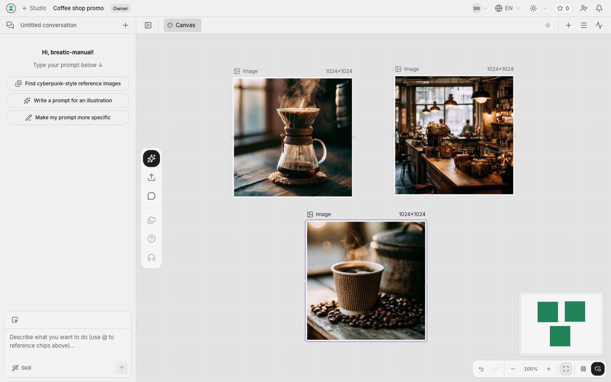
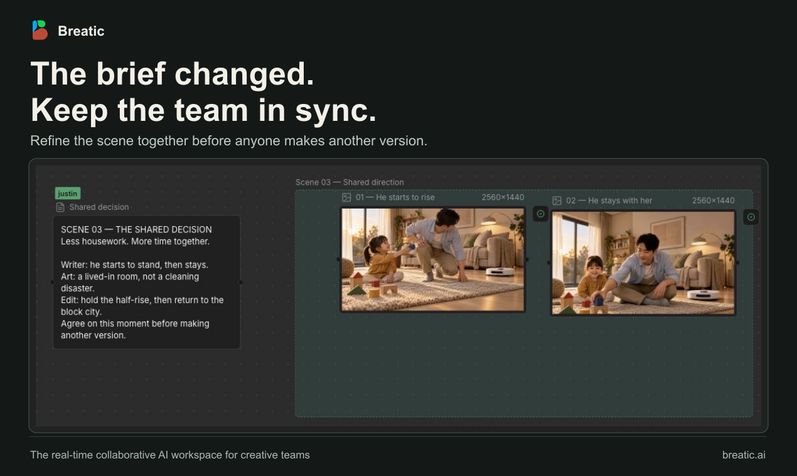
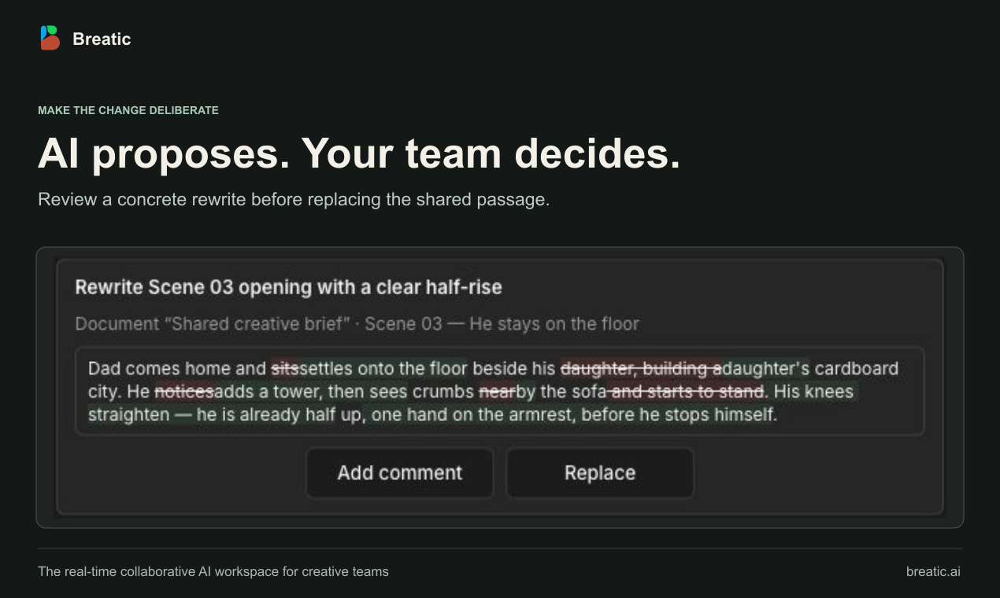

# Breatic

**English** | [简体中文](README-CN.md)

**The real-time collaborative AI workspace for creative teams.**

Bring your brief, scenes and media into one project. Write in Document Spaces, generate and refine assets in Canvas Spaces, and work with an AI agent and collaborators in the context of your production.

**Available online · Source-available · Desktop browser**

[Try Breatic][hosted-app] · [Watch the 45-second demo](https://youtu.be/mc1XAqtJD_M) · [User guide](docs/USAGE.md) · [Self-host](self-host/LOCAL.md) · [Releases](https://github.com/orime-org/breatic/releases)

The hosted service has a free Starter plan. AI generation credits are purchased separately and are not included in membership plans. See [pricing and credits][hosted-pricing].

*A canvas example: compare generated visuals alongside the project's chat.*

## What you can do

| Capability | Use it to |
| --- | --- |
| **Projects with multiple Spaces** | Keep a brief, scenes and alternative creative directions together, with a separate tab for each Space. |
| **Document Spaces** | Write scripts, shot descriptions and production checklists with headings, lists and formatted text. |
| **Canvas Spaces** | Arrange references and media on an infinite canvas; generate and refine assets using prompts, models and reference inputs. |
| **3D (DEV)** | Arrange built-in objects in a shared scene and edit their position, rotation and scale. |
| **Timeline (DEV)** | Add Project videos or upload local videos to a shared visual track, adjust start frames and preview the sequence. |
| **An AI agent in your project** | Discuss ideas, provide document or canvas context, and review proposed work alongside your materials. |
| **Real-time collaboration** | Invite collaborators, set project access permissions and work on synchronized canvases, documents, 3D scenes and Timelines. |

Supported media includes images, video, audio and 3D assets. Generation capabilities depend on configured providers and model access. Canvas and Document Spaces are available; the 3D and Timeline editors carry **DEV** badges in both creation entries. The current Timeline supports video arrangement and preview on one visual track. Multi-track editing, additional media types, Web Animation and video export are planned. Model generation and annotations within the 3D scene are under development.

## Review changes together

When a brief changes, keep the decision beside the work. This example shows two scene images alongside a shared direction that a collaborator edited in the project.

The agent can propose a rewrite for review before replacing a passage in the shared document. The team decides what to keep.

These are captures from a real example project; the story and scene assets are illustrative.

## A creative workflow: a 30-second coffee-shop video

A **Studio** holds your projects and assets. A **Project** brings together one production; its **Spaces** divide the work by scene, deliverable or creative direction.

| Space | Type | What it holds |
| --- | --- | --- |
| Script and brief | Document | The story, brand direction, dialogue and shot descriptions |
| 01 · Opening · 0–10s | Canvas | References and candidate visuals for the opening shot |
| 02 · Main scene · 10–20s | Canvas | Scene assets and variations to compare |
| 03 · Ending · 20–30s | Canvas | The closing shot and its supporting assets |

1. **Write the brief.** Describe the coffee shop, audience and visual direction in the document.
2. **Work with the agent.** Bring relevant context into chat, discuss the shots and review its proposed work.
3. **Develop each scene.** Choose a configured model, add prompts and references, and generate or refine assets on its canvas.
4. **Review and deliver.** Compare results with collaborators, keep the chosen assets and download them for production.

The time ranges are a planning convention: Space names do not set clip duration or assemble a finished video. Use Timeline for video arrangement and preview; finishing and exporting the production use your video editor. The [illustrated user guide](docs/USAGE.md#example-from-a-brief-to-a-visual) shows a brief-to-visual example.

## Get started

| Your goal | Start here |
| --- | --- |
| Use the hosted product | [Open Breatic][hosted-app] in a desktop browser and register or sign in |
| Install for personal, private-group or internal organizational use | [Personal and LAN deployment](self-host/LOCAL.md) |
| Modify the source or contribute | [Development setup](self-host/DEVELOPMENT.md) |

After signing in, finish your personal Studio setup, create a project and add Document, Canvas, 3D or Timeline Spaces with the **+** button. Start with a brief, upload references or arrange built-in 3D objects. The [user guide](docs/USAGE.md) covers registration, your first project, Space operations and [keyboard shortcuts](docs/USAGE.md#keyboard-shortcuts).

### Before self-hosting

Installation uses published Docker images for web, API, background jobs and collaboration, backed by PostgreSQL and Redis. Uploads and media processing use an Ingest Worker and media container in **your Cloudflare account**, with storage in your R2 bucket. AI calls use your provider accounts and quota.

This is not an offline or wholly on-premises installation. LAN access needs trusted HTTPS. Cloud services and model calls can incur charges; SMTP, Google sign-in, Stripe payments and search are optional integrations. Follow the installation guide for cloud provisioning and verification; its one-time Node/pnpm/Wrangler step does not mean running a development server for normal use.

## Project status and help

Breatic's hosted service is available online, and development continues. The feature-specific DEV labels and availability notes above still apply. Use [Releases](https://github.com/orime-org/breatic/releases) for published versions and release notes.

[Report a bug](https://github.com/orime-org/breatic/issues/new?template=bug_report.yml) · [Suggest a feature](https://github.com/orime-org/breatic/issues/new?template=feature_request.yml) · [Ask the community](https://discord.gg/Yeu6A4aejN)

For vulnerabilities, follow the private reporting instructions in [SECURITY.md](SECURITY.md).

## Contribute

The application uses TypeScript, React/Vite, Hono, PostgreSQL, Redis/BullMQ and Hocuspocus/Yjs, with a separate Cloudflare Worker for uploads.

[Contribution workflow](CONTRIBUTING.md) · [Development setup](self-host/DEVELOPMENT.md) · [Architecture](docs/ARCHITECTURE.md) · [Testing](docs/TEST-MANDATE.md)

## Follow Breatic

[Website](https://breatic.ai) · [Discord](https://discord.gg/Yeu6A4aejN) · [X](https://x.com/breatic_ai) · [YouTube](https://www.youtube.com/@breatic_ai) · [Instagram](https://www.instagram.com/breatic_ai)

## License and permitted use

Breatic is **source-available** under the [Breatic Source-Available License v1.0](LICENSE), based on Apache 2.0 with additional conditions.

The license permits individual use, private groups that are not publicly advertised or open to general sign-up, and internal deployment within one organization. It prohibits offering Breatic to the public without separate authorization, **whether paid or free**. A domain or a server does not by itself determine the permitted audience. Preserve the product's branding and copyright notices. See the license for the complete terms; public-facing licensing inquiries go to [contact@breatic.ai](mailto:contact@breatic.ai).

Third-party components and notices are documented in [THIRD-PARTY.md](THIRD-PARTY.md).

[hosted-app]: https://breatic.ai/login?utm_source=github&utm_medium=referral&utm_campaign=repository_listing_202610&utm_content=readme_en
[hosted-pricing]: https://breatic.ai/pricing/?utm_source=github&utm_medium=referral&utm_campaign=repository_listing_202610&utm_content=readme_pricing_en

© 2026 Orime, Inc.
