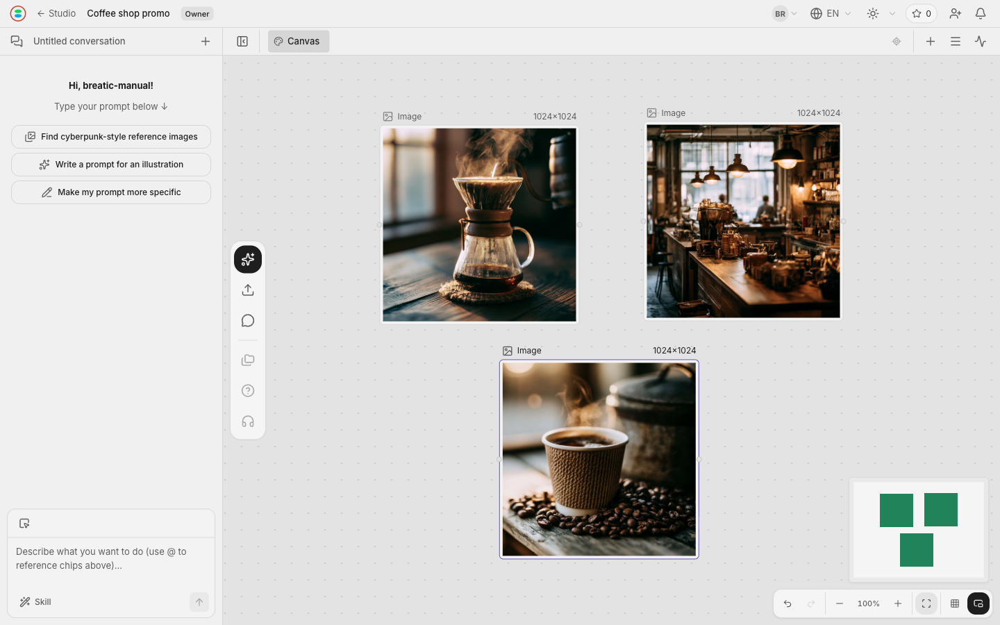
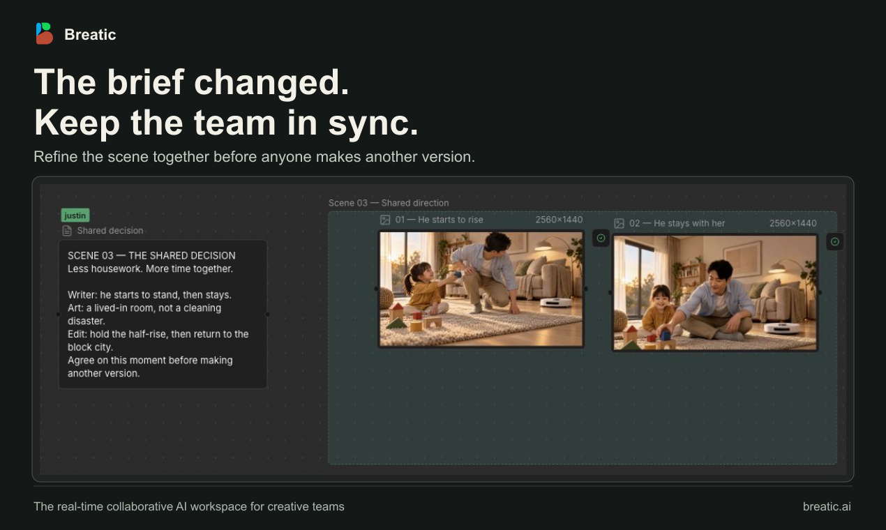
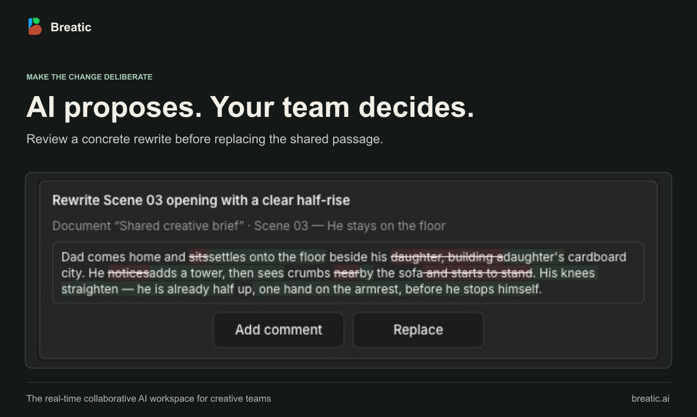

<h1 align="center">Breatic</h1>

<strong>The real-time collaborative AI workspace for creative teams.</strong>

Available online · Source available · Desktop browser

  <a href="https://breatic.ai/?utm_source=github&amp;utm_medium=referral&amp;utm_campaign=repository_listing_202610&amp;utm_content=readme_website_en">Website</a> ·
  <a href="https://breatic.ai/login?utm_source=github&amp;utm_medium=referral&amp;utm_campaign=repository_listing_202610&amp;utm_content=readme_en">Try Breatic</a> ·
  <a href="https://youtu.be/mc1XAqtJD_M">45-second demo</a> ·
  <a href="docs/USAGE.md">User guide</a> ·
  <a href="https://discord.gg/Yeu6A4aejN">Discord</a>

  
  
  
  
  

  <strong>English</strong> · <a href="README-CN.md">简体中文</a> · <a href="README-TW.md">繁體中文</a> · <a href="README-JA.md">日本語</a> · <a href="README-KO.md">한국어</a> · <a href="README-ES.md">Español</a> · <a href="README-PT-BR.md">Português</a> 
  <a href="README-DE.md">Deutsch</a> · <a href="README-FR.md">Français</a> · <a href="README-AR.md">العربية</a> · <a href="README-RU.md">Русский</a> · <a href="README-UK.md">Українська</a> · <a href="README-TR.md">Türkçe</a> · <a href="README-TH.md">ภาษาไทย</a>

---

Bring your brief, scenes and media into one project. Write in Document Spaces, generate and refine assets in Canvas Spaces, and work with an AI agent and collaborators in the context of your production.

The hosted service has a free Starter plan. AI generation credits are purchased separately and are not included in membership plans. See [pricing and credits][hosted-pricing].

## One project, four collaborative creative spaces

In Breatic, you can revise the script, try different visuals, stage scenes, and arrange shots as you go. When you work with a team, everyone can work in the same project at the same time.

| Feature | **Breatic** | Higgsfield | TapNow | LibTV | Luma | LTX Studio |
| --- | :---: | :---: | :---: | :---: | :---: | :---: |
| **Collaborative documents** | ✅ | ✗ | ✗ | ✗ | ✗ | ✗ |
| **Collaborative canvas** | ✅ | ✅ | ✅ | ✅ | ✅ | ✅ |
| **Collaborative 3D** | ✅ | ✗ | ✗ | ✗ | ✗ | ✗ |
| **Collaborative timeline** | ✅ | ✗ | ✗ | ✗ | ✗ | ✗ |
| 3D previs | ✅ | ✅ | ✅ | ✅ | ✗ | ✗ |
| Timeline editing | ✅ | ✗ | ✅ | ✅ | ✗ | ✅ |
| Project agent | ✅ | ✅ | ✅ | ✅ | ✅ | ✗ |
| Review suggested rewrites | ✅ | ✗ | ✗ | ✗ | ✗ | ✗ |
| Team sharing | ✅ | ✅ | ✅ | ✅ | ✅ | ✅ |

Collaboration means multiple people can edit the same workspace in real time. Reviewing suggested rewrites means you can inspect an agent's proposed change before deciding whether to apply it to the original text. This comparison is based on public product information as of November 18, 2026. ✅ means support is confirmed. ✗ means support could not be confirmed from public information.

*A canvas example: compare generated visuals alongside the project's chat.*

## What you can do

| Capability | Use it to |
| --- | --- |
| **Projects with multiple Spaces** | Keep a brief, scenes and alternative creative directions together, with a separate tab for each Space. |
| **Document Spaces** | Write scripts, shot descriptions and production checklists with headings, lists and formatted text. |
| **Canvas Spaces** | Arrange references and media on an infinite canvas; generate and refine assets using prompts, models and reference inputs. |
| **3D (DEV)** | Arrange built-in objects, imported glTF models and AI-generated models in a shared scene, edit their position, rotation and scale, pose characters with presets or joint by joint, change each part's colour, finish and picture, set up shared cameras and lights in a director console that shows every camera's live picture, and frame a still of the scene or of any camera to add to the Agent, a Canvas or the clipboard. |
| **Timeline (DEV)** | Arrange video, images, audio and text on shared tracks, from the Project's media or uploaded local files; any track holds any kind of clip: move, trim, split, duplicate and delete clips, undo your own edits and preview the sequence. Add finished web animations from Motion Spaces as clips that play on the Timeline clock; each addition is an independent copy. Videos, images, text and web animations on every track play together as stacked layers, and video and audio clips are mixed, each at its own volume; select a layer in the preview to move, scale, stretch or rotate it, or type its position and size. Pick the frame's aspect ratio from seven presets (16:9, 9:16, 1:1, 4:3, 4:5, 2:3, 21:9) at the end of the play bar; layers keep their place in the frame. |
| **Motion (DEV)** | Describe a web animation and run it with DeepSeek, follow runs under Completed, In progress and Failed, play and seek finished results, modify a result into a new one, annotate moments with collaborators, export a result as a video and put the video on a Canvas. |
| **An AI agent in your project** | Discuss ideas, provide document or canvas context, and review proposed work alongside your materials. |
| **Real-time collaboration** | Invite collaborators, set project access permissions and work on synchronized canvases, documents, 3D scenes, Timelines and Motion Spaces. |

Supported media includes images, video, audio and 3D assets. Generation capabilities depend on configured providers and model access. Canvas and Document Spaces are available; the 3D, Timeline and Motion editors carry **DEV** badges in both creation entries. The current Timeline edits and previews video, images, audio, text and web animations on any track; Motion makes, modifies and exports web animations, which run only on deployments that enable them. Timeline video export is planned. Annotations within the 3D scene are under development.

## Review changes together

When a brief changes, keep the decision beside the work. This example shows two scene images alongside a shared direction that a collaborator edited in the project.

The agent can propose a rewrite for review before replacing a passage in the shared document. The team decides what to keep.

These are captures from a real example project; the story and scene assets are illustrative.

## A creative workflow: a 30-second coffee-shop video

A **Studio** holds your projects and assets. A **Project** brings together one production; its **Spaces** divide the work by scene, deliverable or creative direction.

| Space | Type | What it holds |
| --- | --- | --- |
| Script and brief | Document | The story, brand direction, dialogue and shot descriptions |
| 01 · Opening · 0–10s | Canvas | References and candidate visuals for the opening shot |
| 02 · Main scene · 10–20s | Canvas | Scene assets and variations to compare |
| 03 · Ending · 20–30s | Canvas | The closing shot and its supporting assets |

1. **Write the brief.** Describe the coffee shop, audience and visual direction in the document.
2. **Work with the agent.** Bring relevant context into chat, discuss the shots and review its proposed work.
3. **Develop each scene.** Choose a configured model, add prompts and references, and generate or refine assets on its canvas.
4. **Review and deliver.** Compare results with collaborators, keep the chosen assets and download them for production.

The time ranges are a planning convention: Space names do not set clip duration or assemble a finished video. Use Timeline for arrangement and preview; finishing and exporting the production use your video editor. The [illustrated user guide](docs/USAGE.md#example-from-a-brief-to-a-visual) shows a brief-to-visual example.

## Get started

| Your goal | Start here |
| --- | --- |
| Use the hosted product | [Open Breatic][hosted-app] in a desktop browser and register or sign in |
| Install for personal, private-group or internal organizational use | [Personal and LAN deployment](self-host/LOCAL.md) |
| Modify the source or contribute | [Development setup](self-host/DEVELOPMENT.md) |

After signing in, finish your personal Studio setup, create a project and add Document, Canvas, 3D, Timeline or Motion Spaces with the **+** button. Start with a brief, upload references or arrange built-in 3D objects. The [user guide](docs/USAGE.md) covers registration, your first project, Space operations and [keyboard shortcuts](docs/USAGE.md#keyboard-shortcuts).

### Before self-hosting

Installation uses published Docker images for web, API, background jobs and collaboration, backed by PostgreSQL and Redis. Uploads and media processing use an Ingest Worker and media container in **your Cloudflare account**, with storage in your R2 bucket. AI calls use your provider accounts and quota.

This is not an offline or wholly on-premises installation. LAN access needs trusted HTTPS. Cloud services and model calls can incur charges; SMTP, Google sign-in and search are optional integrations; selling credits or memberships may be enabled only with written authorization from Orime, Inc. (LICENSE sections 10 and 11). Follow the installation guide for cloud provisioning and verification; its one-time Node/pnpm/Wrangler step does not mean running a development server for normal use.

## Project status and help

Breatic's hosted service is available online, and development continues. The feature-specific DEV labels and availability notes above still apply. Use [Releases](https://github.com/orime-org/breatic/releases) for published versions and release notes.

[Report a bug](https://github.com/orime-org/breatic/issues/new?template=bug_report.yml) · [Suggest a feature](https://github.com/orime-org/breatic/issues/new?template=feature_request.yml) · [Ask the community](https://discord.gg/Yeu6A4aejN)

For vulnerabilities, follow the private reporting instructions in [SECURITY.md](SECURITY.md).

## Contribute

The application uses TypeScript, React/Vite, Hono, PostgreSQL, Redis/BullMQ and Hocuspocus/Yjs, with a separate Cloudflare Worker for uploads.

[Contribution workflow](CONTRIBUTING.md) · [Development setup](self-host/DEVELOPMENT.md) · [Architecture](docs/ARCHITECTURE.md) · [Testing](docs/TEST-MANDATE.md)

## Follow Breatic

[Website](https://breatic.ai) · [Discord](https://discord.gg/Yeu6A4aejN) · [X](https://x.com/breatic_ai) · [YouTube](https://www.youtube.com/@breatic_ai) · [Instagram](https://www.instagram.com/breatic_ai)

## License and permitted use

Breatic is **source-available** under the [Breatic Source-Available License 2.0](LICENSE), a license derived from the Apache License 2.0 with additional conditions. It is not an OSI-approved open-source license.

- You may obtain, modify and self-host Breatic for personal use, a private noncommercial group or use within your organization, including in your business, without a software license fee (LICENSE section 10).
- You may make and sell creative works with Breatic, such as films, advertisements, images, audio and 3D assets; LICENSE sections 10 and 13 give the conditions.
- Without separate written authorization from Orime, Inc., an instance you operate must run in Self-Deployment Mode: in-app credit purchases, paid memberships, subscriptions and other paid-operation features stay disabled (LICENSE section 10).
- Making Breatic, or a substantial set of its platform features, available to people outside those uses for a commercial purpose needs separate written authorization (LICENSE section 11).
- Keep the Breatic name and supplied logo visible in the application's identity area and keep the license and attribution notices reachable (LICENSE section 12). Orime, Inc. is an authorized licensor of the Breatic marks; [TRADEMARKS.md](TRADEMARKS.md) describes the branding rules.
- Versions released under an earlier license, including AGPL-3.0-only, keep the license they were released under (LICENSE section 15).

The complete terms are in [LICENSE](LICENSE).

### Generated content

Breatic is a tool for AI-assisted content creation. Operators and users of a Breatic instance are responsible for making sure generated content complies with applicable law (copyright, trademark, privacy, data protection, defamation and content moderation), for holding the rights to the inputs they supply and to their downstream use, and for moderating content in their context of use. Orime, Inc. makes no warranty about the accuracy, legality, originality or safety of generated content.

Third-party components and notices are documented in [THIRD-PARTY.md](THIRD-PARTY.md).

[hosted-app]: https://breatic.ai/login?utm_source=github&utm_medium=referral&utm_campaign=repository_listing_202610&utm_content=readme_en
[hosted-pricing]: https://breatic.ai/pricing/?utm_source=github&utm_medium=referral&utm_campaign=repository_listing_202610&utm_content=readme_pricing_en

© 2026 Orime, Inc.
