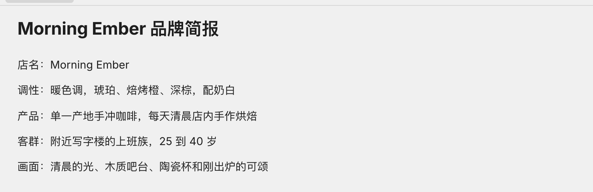
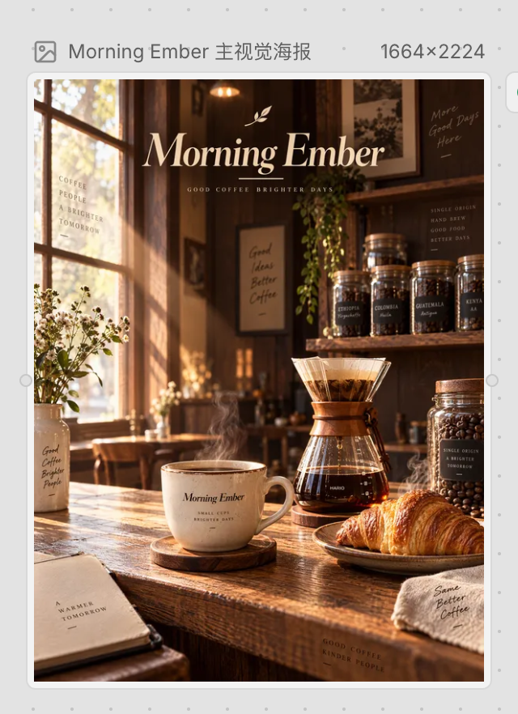

# Breatic 使用指南

[English](USAGE.md) | **简体中文** · [产品介绍](../README-CN.md)

在桌面浏览器中使用 Breatic。使用官方在线产品时先[注册或登录](https://breatic.ai/login)；自行部署时先完成[个人与局域网指南](../self-host/LOCAL-CN.md)，开发者请使用[开发环境指南](../self-host/DEVELOPMENT-CN.md)。

## 创建第一个项目

安装完成后：

1. 在桌面浏览器中打开实例地址，注册账号并完成个人 Studio 设置。启用了邮件时，输入邮件里的 6 位验证码完成注册；未启用邮件时，保存注册后显示的恢复码。没有共用的默认密码，也没有免登录模式。
2. 为要创作的内容创建项目，选择初始 Space 类型。
3. 点击项目 Space 栏中的 **+**，添加 **Document** Space，命名为“剧本与创作简报”，写下故事或需求。如果初始 Space 已选文档，直接使用它即可。
4. 按场景或创意方向添加一个或多个 **Canvas** Space，分别命名，上传参考素材或添加节点，开始创作。
5. 通过标签页切换 Space，通过 Space 列表查找、管理项目中的其他空间。使用聊天和画布工具，通过已配置的模型生成、调整资产。
6. 与允许访问该实例的协作者分享项目，并设置他们的访问权限。

Space 标签最左侧的小 loading 表示当前浏览器已知该 Space 有工作正在进行，包含已反映到本端的协作者任务。切到其他 Space 后，原标签继续更新；悬停忙态标签可查看完整名字和运行状态。

如果加入的是现有实例，直接使用部署者提供的地址，从注册账号开始，不需要另外部署。部署者应在邀请用户前，完成部署指南中的登录、持久化、协作、上传和生成检查。

## 在 Breatic 中工作

- **编写创作计划：** 在 Document Space 中用标题划分场景、列表记录镜头描述、待办列表跟进制作任务。选中文字进行格式调整，或使用下方的文档快捷键。
- **添加与排列内容：** 上传参考素材，或在画布空白处右键选择节点类型。拖动节点调整位置，在空白处拖拽框选区域。
- **浏览画布：** 鼠标滚轮或触控板双指滚动用于平移；双指捏合或 `Ctrl+滚轮` 用于缩放。视图工具栏提供缩放、适应窗口、网格吸附和小地图。双击空白画布不会缩放。
- **处理选中节点：** 右键节点或选区，查看复制、创建副本、分组、重命名、锁定/解锁、下载、删除等可用操作。菜单由当前选区和权限决定，并非每种节点都有所有操作。
- **生成与调整：** 选择已配置的模型，提供提示词及所需参考素材，等待任务产出后继续处理。即使应用服务健康，缺少供应商凭据或额度仍可能阻止生成。
- **协作与保留工作：** 画布修改通过协作服务同步。离开前确认同步和上传已经完成；浏览器断线或任务尚未结束，不能视为内容已经保存。验收持久化时应刷新并重新打开项目。

## 操作快捷键

画布快捷键只在画布空间拥有键盘焦点时生效，不会替代聊天框、文本输入框或编辑器内的输入操作。编辑操作需要写权限，锁定状态或运行中的任务可能限制删除。使用画布快捷键前先点击画布。

### 画布

| 操作 | macOS | Windows / Linux |
| --- | --- | --- |
| 复制选中节点 | `Cmd+C` | `Ctrl+C` |
| 粘贴支持的剪贴板内容 | `Cmd+V` | `Ctrl+V` |
| 创建选中节点的副本，不替换剪贴板 | `Cmd+D` | `Ctrl+D` |
| 撤销画布修改 | `Cmd+Z` | `Ctrl+Z` |
| 重做画布修改 | `Cmd+Shift+Z` | `Ctrl+Shift+Z` 或 `Ctrl+Y` |
| 将符合条件的选区分组 | `Cmd+G` | `Ctrl+G` |
| 取消选中组的分组 | `Cmd+Shift+G` | `Ctrl+Shift+G` |
| 删除允许删除的选中节点 / 连线 | `Backspace` 或 `Delete` | `Backspace` 或 `Delete` |
| 取消正在进行的参考选择或批注放置 | `Esc` | `Esc` |

复制粘贴可能依赖浏览器剪贴板权限与安全上下文，局域网使用应按指南配置可信 HTTPS。`Cmd/Ctrl+A` **不是全选画布节点**：在可编辑内容之外，项目会拦截网页全选，请使用画布选区操作。

### 文档编辑

以下快捷键作用于文档编辑器内部，不用于操作画布节点。macOS 的 `Option` 也可能标为 `Alt`。

| 操作 | macOS | Windows / Linux |
| --- | --- | --- |
| 加粗 / 斜体 / 下划线 | `Cmd+B` / `Cmd+I` / `Cmd+U` | `Ctrl+B` / `Ctrl+I` / `Ctrl+U` |
| 删除线 | `Cmd+Shift+S` | `Ctrl+Shift+S` |
| 行内代码 | `Cmd+E` | `Ctrl+E` |
| 正文段落 | `Cmd+Option+0` | `Ctrl+Alt+0` |
| 一级 / 二级 / 三级标题 | `Cmd+Option+1` / `2` / `3` | `Ctrl+Alt+1` / `2` / `3` |
| 无序列表 | `Cmd+Shift+8` | `Ctrl+Shift+8` |
| 有序列表 | `Cmd+Shift+7` | `Ctrl+Shift+7` |
| 待办列表 | `Cmd+Shift+9` | `Ctrl+Shift+9` |
| 代码块 | `Cmd+Option+C` | `Ctrl+Alt+C` |
| 引用 | `Cmd+Shift+B` | `Ctrl+Shift+B` |

### 聊天

| 操作 | 快捷键 |
| --- | --- |
| 发送当前消息 | `Enter` |
| 插入换行 | `Shift+Enter` |

使用输入法时，按 Enter 确认正在组词的候选内容不会发送消息。是否允许发送仍取决于当前输入和任务状态。

## 实例：从简报到视觉素材

以下截图来自公开的咖啡店教程，展示文档与画布之间的创作流程。

1. 在 Document Space 中写下目标受众、产品卖点和视觉方向。

   

2. 将相关上下文提供给 Agent，讨论画面并评审提案。在画布中选择可用模型，调整提示词和参考素材，再生成资产。
3. 比较或调整结果，下载选定素材，用于最终制作。

   

这个实例展示生成图片，而不是已剪辑完成的视频。结果、模型可用性和费用取决于已配置的供应商。完整操作见[官网教程](https://breatic.ai/zh-CN/tutorials)。
