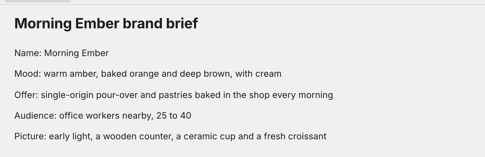
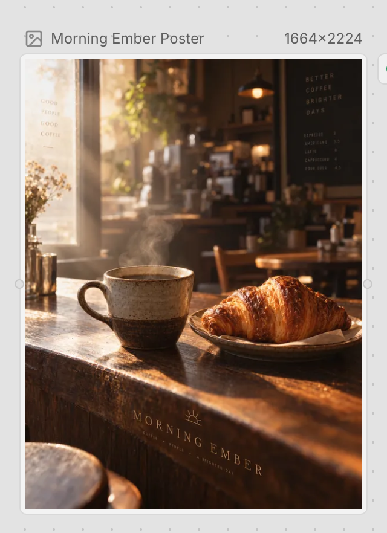

# Working in Breatic

**English** | [简体中文](USAGE-CN.md) · [Product overview](../README.md)

Use Breatic in a desktop browser. [Register or sign in](https://breatic.ai/login) to the hosted product, or complete the [personal and LAN guide](../self-host/LOCAL.md) for your own instance. Contributors should use the [development guide](../self-host/DEVELOPMENT.md).

## Your first project

After completing installation:

1. Open the instance in a desktop browser, register an account and finish your personal Studio setup. With email enabled you confirm the six-digit code mailed to you; with email disabled you save the recovery code shown after signing up. There is no shared default password or login bypass.
2. Create a project for the work you want to make and choose its initial Space type.
3. Use the **+** button in the project's Space bar to add a **Document** Space. Name it “Script and brief” and write the story or requirements. If you started with a Document Space, use that one.
4. Add one or more **Canvas** Spaces for your scenes or creative directions. Give each a meaningful name, then upload references or add nodes to begin working.
5. Switch between Spaces using their tabs; use the Space list to find and manage the project's other Spaces. Use chat and the canvas tools to generate and refine assets with a configured provider.
6. Share the project with permitted collaborators and choose their access permissions.

A small spinning mark at the far left of a Space tab means this browser currently knows of ongoing work in that Space, including collaborator tasks reflected in its current state. It keeps updating while another Space is shown. Hover a busy tab to see its full name and running status.

If you are joining an existing instance, use the address provided by its operator and start with account registration; you do not need to deploy another copy. Operators should complete the deployment guide's login, persistence, collaboration, upload and generation checks before inviting users.

## Working in Breatic

- **Write the plan:** in a Document Space, use headings for scenes, lists for shot descriptions and to-dos for production tasks. Select text to format it, or use the document shortcuts below.
- **Add and arrange content:** upload references, or right-click an empty canvas area to choose a node type. Drag nodes to arrange them; drag across empty canvas to select an area.
- **Navigate the canvas:** scroll with a mouse wheel or two fingers to pan; pinch or use Ctrl+wheel to zoom. The viewport toolbar also provides zoom, fit-to-window, grid snapping and a minimap. Double-clicking empty canvas does not zoom.
- **Work with selected nodes:** right-click a node or selection for available actions such as copy, duplicate, group, rename, lock/unlock, download and delete. The menu depends on the selection and your permissions; not every action applies to every node.
- **Generate and refine:** choose a model you have configured, provide a prompt and any references, and wait for the task result before continuing with the asset. Missing provider credentials or quota can prevent generation even when the application is healthy.
- **Collaborate and keep your work:** canvas changes synchronize through the collaboration service. Check that synchronization and uploads have completed before leaving; a disconnected browser or unfinished task is not proof that work has been stored. Refresh and reopen the project when verifying persistence.

## Arrange videos in Timeline

Choose **Timeline** when creating a Project or adding a Space. Its **DEV** badge marks the editor as under development. The current editor places videos on one visual track.

| Control or action | Result |
| --- | --- |
| **Add media** | Open the material dialog and choose **Project videos** or **Local upload**. |
| Select a Project video or use **Choose video** | Prepare that registered video or upload the selected local file through the upload service. |
| **Start frame**, then **Add to Timeline** | Confirm a whole-frame position. The default is the sequence end; each addition creates an independent clip. |
| Select a clip and press **Change start frame** | Enter its new whole-frame start and press **Apply**. Overlapping clips appear in the conflict list, where each row can be selected for adjustment. |
| **Play**, **Pause** and the preview slider | Play the valid sequence, pause it or select its global frame. Video buffering holds the frame until playback can continue. |
| Close and reopen the Space from the Space list | Continue from the shared Timeline document. Viewers can inspect and preview it. |

A selected conflict row retains its selection border while you edit its start. Its properties show a short conflict status; the preview and conflict list provide the full adjustment instruction. A failed local upload retains its selected file and start frame in the open form for retry.

Full multi-track editing, audio/image/text placement, Web Animation creation and video export are planned additions.

## Arrange a 3D scene

Choose **3D** when creating a project or adding a Space. The type picker orders Canvas, Document, 3D and Timeline; Canvas is selected by default. The 3D and Timeline cards carry **DEV**, and a project created with this type starts with a Space named **3D**.

| Control or action | Result |
| --- | --- |
| Left **Add** button | Open the built-in object menu and add a box or figure. |
| Click an object; Shift-click more objects | Select objects in the viewport or object list. Click empty scene space to clear the selection. |
| Bottom-centre selection menu | Choose Move, Rotate or Scale and drag the native scene handles; frame, duplicate or delete the selection. Multiple objects scale uniformly. |
| Right **Properties** panel | Edit one object's name, position in metres, rotation in degrees and positive scale. Enter or leaving a field applies the value; Escape cancels its draft. |
| Padlock beside the panel's X | Lock or unlock selected objects. An Editor can unlock an object another collaborator locked. Copies start unlocked. |
| Bottom-right bar | From left to right: Undo, Redo, Properties, Scene objects, Generation tasks and the minimap switch. Panel buttons toggle the corresponding right floating panel; its X also closes it. |
| Minimap | Click its top view to navigate your personal viewing camera. |
| AI generation and annotations | The AI dialog and task panel show the development status. Prompt, reference-image selection and generation submission are disabled. The dimmed annotation button explains its status on hover. |

Collaborators share scene objects. Selection, viewing camera and undo history belong to each user. A Viewer can browse and select. Selecting or dragging an unlocked object allows concurrent editing by other Editors. Switching Spaces keeps the live collaborative document, personal selection and undo history while releasing the hidden viewport; closing the Space tab releases that session. The last viewing camera is stored for the current account, Project and Space in this browser.

Switching Spaces retains unfinished property input; reopen Properties on return to continue. Closing the panel, opening another panel or overlay, or changing the selection ends that input. Opening a header menu transfers keyboard focus to the menu. The reference-image entry uses a localized button within the AI dialog.

## Keyboard shortcuts

Canvas shortcuts apply when the canvas Space owns keyboard focus, not while typing in chat, a text field or an editor. Editing actions require write permission. Locked items and nodes with running tasks may restrict deletion. Click the canvas before using a canvas shortcut.

### Canvas

| Action | macOS | Windows / Linux |
| --- | --- | --- |
| Copy selected nodes | `Cmd+C` | `Ctrl+C` |
| Paste supported clipboard content | `Cmd+V` | `Ctrl+V` |
| Duplicate selected nodes without replacing the clipboard | `Cmd+D` | `Ctrl+D` |
| Undo a canvas edit | `Cmd+Z` | `Ctrl+Z` |
| Redo a canvas edit | `Cmd+Shift+Z` | `Ctrl+Shift+Z` or `Ctrl+Y` |
| Group an eligible selection | `Cmd+G` | `Ctrl+G` |
| Ungroup a selected group | `Cmd+Shift+G` | `Ctrl+Shift+G` |
| Delete eligible selected nodes / edges | `Backspace` or `Delete` | `Backspace` or `Delete` |
| Cancel active reference picking or annotation placement | `Esc` | `Esc` |

Copy/paste can depend on browser clipboard permissions and a secure context; use the trusted HTTPS setup in the LAN guide. `Cmd/Ctrl+A` is **not** a select-all-nodes shortcut: outside editable content, the project suppresses page-wide selection. Use canvas selection gestures instead.

### 3D

These shortcuts apply while the 3D Space owns keyboard focus and a text field is not being edited. Editing actions require write permission; manual object locks constrain shared changes.

| Action | macOS | Windows / Linux |
| --- | --- | --- |
| Duplicate selected objects | `Cmd+D` | `Ctrl+D` |
| Delete selected objects | `Backspace` or `Delete` | `Backspace` or `Delete` |
| Undo your scene edit | `Cmd+Z` | `Ctrl+Z` |
| Redo your scene edit | `Cmd+Shift+Z` | `Ctrl+Shift+Z` or `Ctrl+Y` |
| Frame the selection | `F` | `F` |
| Cancel or dismiss | `Esc` | `Esc` |

Escape first cancels an active field draft or transform gesture. Subsequent presses close an open panel and clear the selection. Blur, hiding the scene or losing write permission cancels an unfinished transform gesture.

### Document editing

These shortcuts act inside the document editor, not on canvas nodes. On macOS, `Option` is the key also labeled `Alt`.

| Action | macOS | Windows / Linux |
| --- | --- | --- |
| Bold / italic / underline | `Cmd+B` / `Cmd+I` / `Cmd+U` | `Ctrl+B` / `Ctrl+I` / `Ctrl+U` |
| Strikethrough | `Cmd+Shift+S` | `Ctrl+Shift+S` |
| Inline code | `Cmd+E` | `Ctrl+E` |
| Paragraph | `Cmd+Option+0` | `Ctrl+Alt+0` |
| Heading 1 / 2 / 3 | `Cmd+Option+1` / `2` / `3` | `Ctrl+Alt+1` / `2` / `3` |
| Bulleted list | `Cmd+Shift+8` | `Ctrl+Shift+8` |
| Numbered list | `Cmd+Shift+7` | `Ctrl+Shift+7` |
| To-do list | `Cmd+Shift+9` | `Ctrl+Shift+9` |
| Code block | `Cmd+Option+C` | `Ctrl+Alt+C` |
| Quote | `Cmd+Shift+B` | `Ctrl+Shift+B` |

### Chat

| Action | Shortcut |
| --- | --- |
| Send the current message | `Enter` |
| Insert a line break | `Shift+Enter` |

Enter used to confirm an active input-method composition does not send the message. Submission still depends on the current input and task state.

## Example: from a brief to a visual

These screenshots from the public coffee-shop tutorial show the document-to-canvas workflow.

1. Write the audience, offer and visual direction in a Document Space.

   

2. Give the agent relevant context, discuss the visual and review its proposal. Choose an available model on the canvas, adjust the prompt and references, and generate the asset.
3. Compare or refine the result, then download the chosen asset for your production.

   

This example is a generated image, not a completed video. Results, model availability and costs depend on the configured provider. See the [official tutorials](https://breatic.ai/tutorials) for the full walkthrough.
